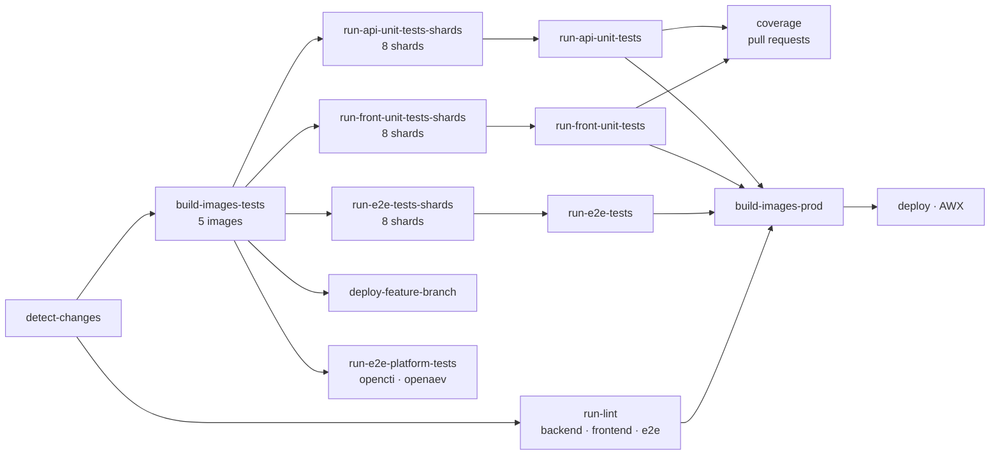

---
paths:
  - ".github/workflows/**"
  - ".github/actions/**"
  - "xtm-hub-dev/**"
  - "chart/**"
  - "**/Dockerfile"
  - "**/*.Dockerfile"
  - ".dockerignore"
---

# CI, Docker & Deployment Instructions

## Main pipeline

`.github/workflows/dockerbuild-ci.yml` runs on `workflow_dispatch`, `merge_group`, pushes to `main` and `v*` tags
(filtered to `apps/**`, `.github/actions/**`, the workflow file, the `xtm-hub-dev/docker-compose-ci*.yml` files,
`package.json`, `yarn.lock`), and pull requests targeting `main` or
`issue/*`.



- **detect-changes** gates the pipeline on a `code` path filter (the same paths as the `push` filter). Its
  `frontend` and `backend` outputs (`apps/frontend/**`, `apps/backend/**`) choose the apps the `coverage` job checks.
- **run-lint** is a matrix over `apps/backend`, `apps/frontend`, `apps/e2e`.
- **build-images-tests** builds `portal-front`, `portal-api`, `portal-e2e-tests`, `portal-front-test`,
  `portal-api-test` in parallel.
- The three test suites each fan out over **8 shards**; the unsharded `run-*-tests` jobs are `always()` aggregators
  that collect the shard results, and they are what `build-images-prod` actually depends on. Unit test jobs are
  skipped on tag builds.
- **run-e2e-platform-tests** runs `tests/platforms/` against the `opencti/platform:rolling` and
  `openaev/platform:rolling` images, one matrix leg per platform, on pull requests and manual runs only. It is
  **non-blocking**: nothing depends on it, it runs with `continue-on-error`, and the "Ready to merge" automation of
  `pr-issue-automation.yml` ignores its checks, so a broken rolling image warns before a release without blocking a
  merge.
  Its compose files are `xtm-hub-dev/docker-compose-ci-opencti.yml` and `docker-compose-ci-openaev.yml`, layered on
  `docker-compose-ci.yml`. Each leg posts its own pull request report ("OpenCTI e2e", "OpenAEV e2e", told apart by a
  `comment-tag`), next to the "XTM Hub e2e" report of the shards, which run the `chromium` Playwright project only.
- **deploy-feature-branch** publishes an ephemeral preview at `https://dev-pr-{number}.hub.staging.filigran.io`.
- **build-images-prod** and **deploy** only run outside pull requests.

If you add a test file, it lands in a shard automatically — do not hardcode shard counts in scripts.

## Vitest pull request report

Each Vitest shard also writes a JSON report (`--reporter=json --includeTaskLocation`) and uploads it as the
`vitest-frontend-report-shard-*` / `vitest-backend-report-shard-*` artifact. `run-front-unit-tests` and
`run-api-unit-tests` then check out the repository (`fetch-depth: 2`, to diff the merge commit against its base) and
call the composite action `.github/actions/vitest-pr-report` with `pull-requests: write`. It merges the shards,
writes the full report to the job summary and keeps one comment per suite up to date on the pull request: every
failed test, and the tests of the test files the pull request changes. The step has `continue-on-error: true`: the
report never turns the gate red, the shards carry the real result.

The logic is in `.github/actions/vitest-pr-report/report-lib.mjs`, covered by
`.github/actions/vitest-pr-report/report.test.mjs` (Node's built-in runner, run by the `backend` leg of `run-lint`). Run it with `node --test .github/actions/vitest-pr-report/report.test.mjs` after changing the script.

## Coverage

The `coverage` job ("Coverage") checks the pull request coverage from the Vitest reports themselves, with the same
rules as `codecov.yml`: one check per app (`apps/frontend/**`, `apps/backend/**`) and an 80% target, on the lines the
pull request changes and on the whole app. Each Vitest shard of a pull request uploads its Istanbul report
(`coverage-final.json`) as the `coverage-frontend-shard-N` / `coverage-backend-shard-N` artifact. The files measured
are the ones each app's `vitest.config.ts` includes in its coverage.

On pull requests, once both shard jobs succeed and `run-front-unit-tests` / `run-api-unit-tests` have posted their
test reports, the job checks out the merge commit the shards tested (`fetch-depth: 2`) and calls the composite action
`.github/actions/coverage` for each app the pull request changes (the `frontend` and `backend` outputs of
`detect-changes`). For each app, it merges the shards (adding up the hit counts) and counts lines like the "% Lines"
column of Vitest: a line is coverable when a statement starts on it, covered when one of them ran. Then it:

- writes the app's coverage and the coverage of its changed lines (the merge commit against its first parent), with
  the changed lines left uncovered, at the top of the app's Vitest report comment, between `<!-- coverage:start -->`
  and `<!-- coverage:end -->` (the app id is the report `id`);
- fails when less than 80% of the coverable changed lines of an app are covered. A change without any coverable line
  (test files, types, assets) passes;
- fails when an app is under 80% overall, or when no coverage report of the app was found.

The logic is in `.github/actions/coverage/coverage-lib.mjs`, covered by `.github/actions/coverage/coverage.test.mjs`
(Node's built-in runner, run by the `backend` leg of `run-lint`). Run it with
`node --test .github/actions/coverage/coverage.test.mjs` after changing the script.

"Coverage" blocks a merge only as a required check of the `main` branch protection. It is skipped, so passing, on a
pull request that does not run the shards or changes neither app, and in the merge queue.

The shards still upload their coverage to Codecov (flags `frontend-shard-N` / `backend-shard-N`, all of them awaited
through `after_n_builds` in `codecov.yml`) for its pull request comment and its `codecov/patch/*` checks. Those are
informational (`informational: true`, they never fail) and no job waits for Codecov: only "Coverage" is required.

Before the Docker builds, migrations and seeds are copied into the e2e workspace:

```bash
cp -r ./apps/backend/src/migrations ./apps/e2e/migrations
cp -r ./apps/backend/tests/seeds ./apps/e2e/seeds
cp ./apps/backend/tests/test-utils.ts ./apps/e2e/test-utils.ts
```

## Feature environments (opt-out)

`deploy-feature-branch` runs for every pull request unless the `skip-feature-env` label is present.

| Label | Feature env deployed? | "Ready for merging" auto-set? |
| --- | --- | --- |
| *(none)* | Yes — default | No; requires manual testing first |
| `skip-feature-env` | No | Yes, once checks and approval pass |

Removing `skip-feature-env` from an open pull request triggers a redeploy through
`.github/workflows/pr-issue-automation.yml`.

## Node and Yarn in CI

- Always resolve Node from `.nvmrc` (`actions/setup-node` with `node-version-file: .nvmrc`). A sparse checkout keeps
  the root files, so `.nvmrc` is there even when a job only checks out one action.
- Always `corepack enable` and let Yarn resolve from the `packageManager` field in the root `package.json`. Do not
  pass an explicit version to `corepack prepare`; a pinned version silently diverges from `packageManager`.
- **Do not set `cache: yarn` on `actions/setup-node`.** That option shells out to the runner's preinstalled global
  yarn 1.x to locate the cache folder, and it runs *before* your `corepack enable` step, so it fails with
  `This project's package.json defines "packageManager": "yarn@4.x". However the current global version of Yarn is
  1.22.x`. Enable Corepack first, then read the folder with `yarn config get cacheFolder` and pass it to
  `actions/cache` — see `copilot-setup-steps.yml` for the working pattern.
- Install with `yarn install --immutable` so a stale `yarn.lock` fails the build instead of being rewritten.

Note `.yarnrc.yml` sets `enableScripts: false` and `npmMinimalAgeGate: 4320` (3 days). Packages published in the last
three days are rejected, and postinstall scripts do not run — anything needing one (browsers, native binaries) must
be installed explicitly.

## Other workflows

`pr-conventions.yml` enforces the commit/PR title convention, `check-dependencies.yml` guards the dependency policy,
`copilot-setup-steps.yml` preinstalls the toolchain for the Copilot coding agent, and `auto-delete-feature-env.yml` /
`delete-feature-branch.yml` handle cleanup.

## Local infrastructure

```bash
docker compose -f xtm-hub-dev/docker-compose.yml up
```

PostgreSQL 5434, Silo (S3) 9002, Elasticsearch 9204, Kibana 5603, PgAdmin 8888, Mailpit 8025/1025. Keep these ports in
sync with `apps/backend/config/default.json` when changing either side.

## Deployment

The Helm chart is in `chart/`. Frontend containers listen on **3000** internally even though dev runs on 3002.

Every AWX job template (deploys, feature environments, anonymized data restore) is launched through the composite
action `.github/actions/awx-launch`, which calls the AWX REST API with `curl` and `jq` from the runner image. Do not
bring back awxkit: it has had no PyPI release since 2024 and breaks on current Python. A job without a full checkout
needs a sparse checkout of `.github/actions/awx-launch` first. The action does not wait for the AWX job to finish.
