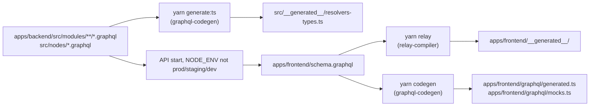

---
paths:
  - "apps/backend/**/*.graphql"
  - "apps/backend/**/*.resolver.ts"
  - "apps/frontend/**/*.graphql.ts"
  - "apps/frontend/graphql/**"
  - "apps/frontend/schema.graphql"
---

# GraphQL Instructions

The schema is authored in the backend and flows to the frontend. Understanding this direction is the single most
important thing about the codebase: **the frontend never edits the schema**.



## Rules

- Author types, queries and mutations in the module's `.graphql` file, next to its resolver and service.
- After a backend schema change, run `yarn workspace @xtm-hub/backend generate:ts` so
  `src/__generated__/resolvers-types.ts` matches.
- `apps/frontend/schema.graphql` is **generated**. It is refreshed when the API starts outside
  production/staging/development. Do not hand-edit it.
- After the schema moves, restart the API so `apps/frontend/schema.graphql` is rewritten (`generate:ts` does not write
  it), then run the two frontend generators. They read that file, so running them before the restart uses a stale schema:
  - `yarn workspace @xtm-hub/frontend relay` compiles the `graphql` tagged templates of the Relay pages into
    `apps/frontend/__generated__/` (gitignored). Run it after a schema change or a Relay template edit. Skipping it is the
    most common source of bogus frontend type errors.
  - `yarn workspace @xtm-hub/frontend codegen` regenerates `apps/frontend/graphql/generated.ts` and
    `apps/frontend/graphql/mocks.ts` from the schema and the `apps/frontend/graphql/**/*.graphql` operations. Run it after
    a schema change or after editing one of those operation files. Both outputs are **tracked**: commit them with the change.
- Resolvers are merged in `apps/backend/src/server/graphql-schema.ts`. A new module's resolver has to be registered
  there or its fields silently do not exist.
- Adding, renaming, or reshaping an operation? Update the matching `.bru` request under `bruno/` too — see
  [`backend.md`](backend.md#api-collection-bruno).
- In the frontend, all the mutations of an epic should be in a .mutation.graphql file and the query in a .query.graphql
  file. We don't want one file by query or mutation.

## Authorization

Access control belongs on the schema through the `@auth` directive, implemented by the transformer in
`apps/backend/src/security/directive-graphql/`. Prefer declaring it on the field over hand-rolling checks inside a
resolver.

## Relay conventions (existing pages only)

- The schema is Relay-compatible: it exposes the `Node` interface (`apps/backend/src/nodes/`) and Connection/PageInfo
  types (`apps/backend/src/modules/common/`).
- Paginated fields must return a Connection, and the backend side should use `paginate()` from the Knex layer.
- Frontend operations live in `*.graphql.ts` files using the `graphql` tagged template; artifacts land in
  `apps/frontend/__generated__/` (aliased as `@generated/*`).

## `@tanstack/react-query` conventions (new frontend work)

- Frontend operations live in `apps/frontend/graphql/<domain>/<name>.query.graphql` (or `.mutation.graphql`).
- `yarn workspace @xtm-hub/frontend codegen` (`graphql-codegen`, `typescript-react-query` plugin) refreshes
  `apps/frontend/graphql/generated.ts` (aliased `@graphql/*`), which exports a typed `use<Name>Query` /
  `use<Name>Mutation` hook plus its query key per operation, and `apps/frontend/graphql/mocks.ts` (mock data builders
  for tests).
- Call the hook with `portalGraphqlClient` from `apps/frontend/src/lib/graphql-client.ts` (a `graphql-request`
  client) as the first argument; manage cache invalidation with `@tanstack/react-query`'s `useQueryClient()`.
- An expired session is handled once, by the `QueryClient` from `getQueryClient()`
  (`apps/frontend/src/lib/query-client.ts`): in the browser it redirects to the login page, does not retry, and keeps a
  failed mutation's own `onError` from running. Do not check for `UnauthenticatedError` in a react-query hook's options
  or callbacks. On the server it lets the `UnauthenticatedError` reach the caller, for
  `redirectToSignupOnUnauthenticated`.
- In application code, get a `QueryClient` only from `getQueryClient()` in `apps/frontend/src/lib/query-client.ts`,
  never with `new QueryClient()` (tests render with their own, from `testRender`): it returns a new client on each
  server call, so one visitor's data never lands in another's render, and one client for the browser session. Its
  `staleTime` keeps a hydrated query from refetching on mount, so a mutation has to invalidate the queries it changes.

### Server rendering

For data a page fetches on the server, pick the model by whether a client `use<Name>Query` hook reads the same query key
(operation and variables). Another call of the same operation with other variables is another query:

- **No client hook reads that key**: fetch it in the server component with the generated document or fetcher, as
  `XtmRoadmap.tsx` does, and render it there or pass it as props to a client component, which refreshes it with
  `router.refresh()` or a Server Action, as the edit-mode drafts in `app/(application)/app/layout.tsx` do. The operation
  still lives in `apps/frontend/graphql/`; only the `QueryClient` and the hydration are left out.
- **A client hook reads that key**: prefetch it on the server and hydrate it. Passing data only as props bypasses the
  query cache. `initialData` does populate that cache and supports invalidation, but does not update an existing entry
  when newer server data arrives; use hydration for this model.

```tsx
const queryClient = getQueryClient();
await queryClient.prefetchQuery({
  queryKey: featureVotingKeys.current(variables), // the exact key the client hook passes
  queryFn: useCurrentVotingRoundQuery.fetcher(await getAuthenticatedGraphqlClient(), variables),
});
return (
  <HydrationBoundary state={dehydrate(queryClient)}>
    <FeatureVotingList {...props} />
  </HydrationBoundary>
);
```

Reference: `apps/frontend/src/components/feature-voting/PrefetchedFeatureVotingList.tsx`, rendered by both
feature-voting pages.

- Build the `queryKey` from the domain's `*.keys.ts`, with the same variables as the client hook. A key that differs is
  a silent miss: the page renders its loading state and the client fetches again.
- `prefetchQuery` swallows errors and a failed query is not dehydrated, so the client fetches it again. When the page
  must redirect or 404 on failure, use `fetchQuery` instead (it throws), wrapped in `redirectToSignupOnUnauthenticated`
  for an anonymous visitor.
- Pick the `queryFn` client by the server-side fetch rules in [`frontend.md`](frontend.md#data-fetching).

## Subscriptions

Delivered over GraphQL SSE (`graphql-sse`) on `/graphql-sse`, backed by the PubSub in `apps/backend/src/pub.ts`. The
Next.js `proxy.ts` (the Next.js 16 convention file, renamed from `middleware.ts`) proxies that path to the API.
