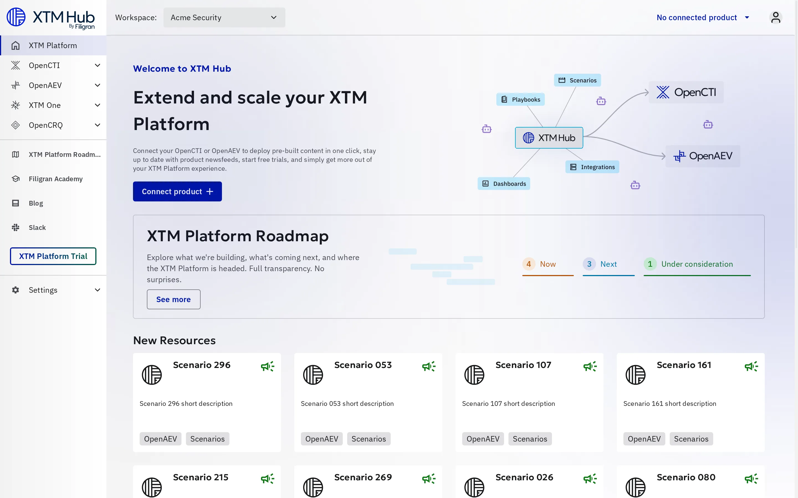
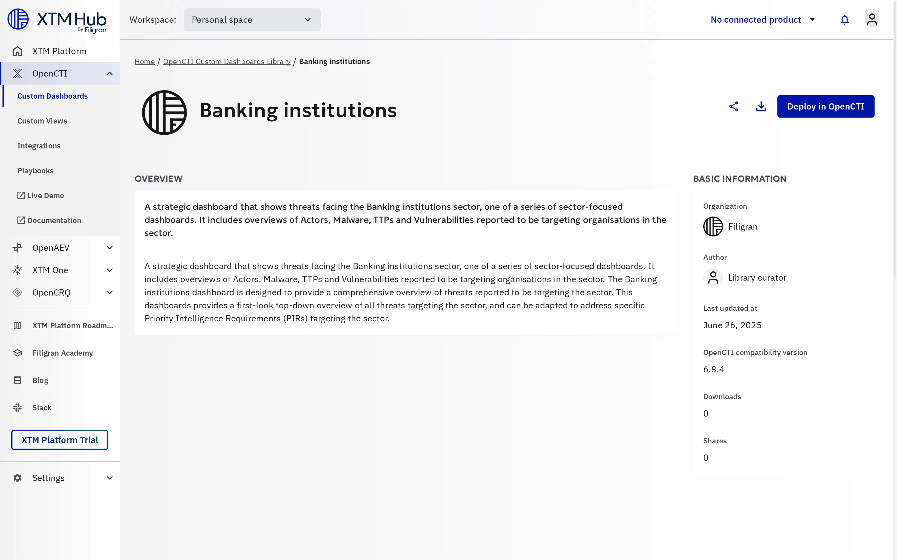
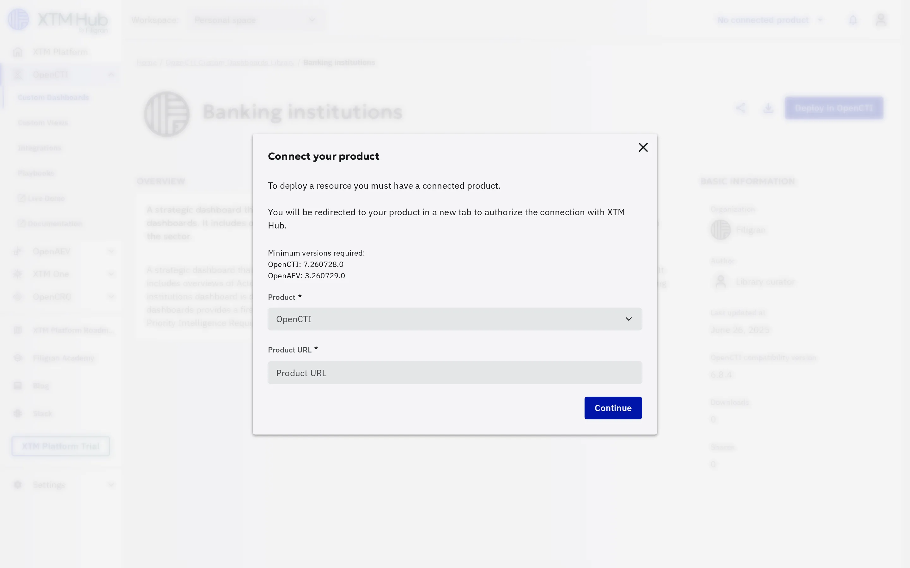

<h1 align="center">
  <a href="https://hub.filigran.io"></a>
</h1>
<p align="center">
  <a href="https://github.com/XTM-Hub/xtm-hub/stargazers"></a>
  <a href="https://github.com/XTM-Hub/xtm-hub/releases"></a>
  <a href="./LICENSE"></a>
  <a href="https://docs.hub.filigran.io"></a>
  <a href="https://community.filigran.io"></a>
  <a href="https://github.com/XTM-Hub/xtm-hub/actions/workflows/dockerbuild-ci.yml"></a>
</p>

<p align="center"><b>The gateway and library of the XTM Platform: CTEM tradecraft you deploy in one click into your own OpenCTI and OpenAEV.</b></p>

XTM Hub is where security teams find ready-made tradecraft for Continuous Threat Exposure Management (CTEM): OpenCTI dashboards, custom views, integrations and playbooks, and OpenAEV attack scenarios. Connect your instance once, then deploy any resource into it in one click instead of rebuilding it by hand. It is also the front door of the XTM Platform: product registration, free trials and the public roadmap of OpenCTI, OpenAEV, OpenCRQ, XTM One and XTM Hub.

> If XTM Hub or the XTM Platform helps your team, **star this repository**. It is the simplest way to help the project reach more defenders.

<p align="center">
  <picture>
    <source media="(prefers-color-scheme: dark)" srcset="./.github/img/hub-home-dark.webp">
    
  </picture>
</p>

## Table of contents

- [Why XTM Hub](#why-xtm-hub)
- [What XTM Hub serves to each product](#what-xtm-hub-serves-to-each-product)
- [Deploy in one click](#deploy-in-one-click)
- [Coming in the next release](#coming-in-the-next-release)
- [The XTM Platform](#the-xtm-platform)
- [Development quick start](#development-quick-start)
- [Contributing](#contributing)
- [Community](#community)
- [Security policy](#security-policy)
- [License](#license)
- [About](#about)

## Why XTM Hub

A CTEM program runs on tradecraft: the dashboards that scope threats to your sector, the integrations that feed your threat intelligence, the playbooks that automate triage and the attack scenarios that validate your defenses. Building each one from scratch takes days. XTM Hub turns them into a shared library:

- **Scope**: sector and threat dashboards for OpenCTI show which actors, malware, TTPs and vulnerabilities target organizations like yours.
- **Discover**: OpenCTI integrations and playbooks bring new intelligence sources and automation into your instance.
- **Validate**: OpenAEV scenarios test your security controls against the techniques that matter, from atomic tests to full attack simulations.
- **Act**: every resource deploys into a connected instance in one click, and the library tells you what is new and what other teams deploy most.

## What XTM Hub serves to each product

| Product | What the Hub provides | Status |
| --- | --- | --- |
| [OpenCTI](https://github.com/OpenCTI-Platform/opencti) | Custom dashboards, custom views, integrations (connectors and feeds) and playbooks; instance registration | Released |
| [OpenAEV](https://github.com/OpenAEV-Platform/openaev) | Attack scenarios (atomic testing, attack simulation, CTEM framework, purple team, tabletop exercises and more); instance registration | Released |
| [XTM One](https://github.com/XTM-One-Platform/xtm-one) | Instance registration and the XTM Platform trial that includes XTM One | Released |
| [OpenCRQ](https://github.com/OpenCRQ-Platform/opencrq) | Feature voting on the XTM Platform roadmap | Released |
| All products | The public XTM Platform roadmap with feature voting, product newsfeeds, personal API tokens for automation | Released |

## Deploy in one click

Open a resource, choose **Deploy in OpenCTI** (or **Deploy in OpenAEV**), pick one of your connected instances, and the Hub sends the resource straight to it. No export, no file to move, no manual import.

<p align="center">
  <picture>
    <source media="(prefers-color-scheme: dark)" srcset="./.github/img/hub-deploy-dark.webp">
    
  </picture>
</p>

The first deployment asks you to connect an instance. Registration links your OpenCTI, OpenAEV or XTM One to your organization in the Hub, so every later deployment is one click.

<p align="center">
  <picture>
    <source media="(prefers-color-scheme: dark)" srcset="./.github/img/hub-connect-dark.webp">
    
  </picture>
</p>

Personal API tokens, created from your profile with a scope (read, read and write, admin) and a lifetime, let your scripts and pipelines call the Hub API without a password.

## Coming in the next release

These capabilities are in open pull requests. They are a preview: names and behavior may change before they ship.

- **Hunt packs** for OpenCTI: a library of ready-made threat hunts to run against your own data ([#3890](https://github.com/XTM-Hub/xtm-hub/pull/3890), with the catalog support in [#3667](https://github.com/XTM-Hub/xtm-hub/pull/3667)).
- **Coverage search** for integrations: coverage facets and a coverage search to find the integrations that fill a gap in your intelligence ([#3661](https://github.com/XTM-Hub/xtm-hub/pull/3661)).
- **Threat Pulse**: a threat aggregation service in the Hub ([#3662](https://github.com/XTM-Hub/xtm-hub/pull/3662)).

## The XTM Platform

XTM Hub is one of five products that together run a CTEM program, from threat signal to validated action.

| Repository | What it does |
| --- | --- |
| [OpenCTI](https://github.com/OpenCTI-Platform/opencti) | Threat intelligence: knowledge of the threats that target you |
| [OpenAEV](https://github.com/OpenAEV-Platform/openaev) | Adversarial exposure validation: test your defenses against those threats |
| [OpenCRQ](https://github.com/OpenCRQ-Platform/opencrq) | Cyber risk quantification: turn exposure into business risk |
| [XTM One](https://github.com/XTM-One-Platform/xtm-one) | The agentic layer that runs CTEM across the products |
| [XTM Hub](https://github.com/XTM-Hub/xtm-hub) | The gateway and library of tradecraft for all of them |

## Development quick start

XTM Hub is a TypeScript monorepo on Yarn workspaces: a GraphQL backend (`apps/backend`, Express, Apollo Server, PostgreSQL, Elasticsearch, S3-compatible storage) and a Next.js frontend (`apps/frontend`). The Node version comes from [`.nvmrc`](.nvmrc) and the Yarn version from `packageManager` in [`package.json`](package.json).

```bash
corepack enable                                       # required before any yarn command
yarn install                                          # installs every workspace
docker compose -f xtm-hub-dev/docker-compose.yml up   # PostgreSQL, S3 storage, Elasticsearch, Kibana, Mailpit
yarn dev:api                                          # backend on http://localhost:4002
yarn dev:front                                        # frontend on http://localhost:3002, start the API first
```

In development the backend seeds sample library content, so the library is not empty on first start. Validation commands, coding rules and the rules of each area are in [AGENTS.md](AGENTS.md).

## Contributing

- Read the [contributing guide](CONTRIBUTING.md) and the [code of conduct](CODE_OF_CONDUCT.md).
- New to the codebase? Start with the [good first issues](https://github.com/XTM-Hub/xtm-hub/issues?q=is%3Aissue%20state%3Aopen%20label%3A%22good%20first%20issue%22).
- Pull request titles follow Conventional Commits and end with the issue they close, for example `fix(frontend): keep the filter on reload (#123)`. Commits are signed.

## Community

- Report a bug or ask for a feature in [GitHub issues](https://github.com/XTM-Hub/xtm-hub/issues).
- Vote on what comes next on the [XTM Platform roadmap](https://hub.filigran.io).
- Join the discussion on the [Filigran community Slack](https://community.filigran.io).
- Like the project? [Star XTM Hub](https://github.com/XTM-Hub/xtm-hub/stargazers) and the other XTM Platform repositories.

## Security policy

Please do not report a security vulnerability in a public issue. Send it to [contact@filigran.io](mailto:contact@filigran.io) with a description, the affected version and the steps to reproduce.

## License

The source code is available for transparency and learning: you may read it, fork it for personal or educational use, and contribute through issues and pull requests. Production and commercial use are not permitted. See [LICENSE](LICENSE) for the full terms.

## About

XTM Hub is designed and developed by [Filigran](https://filigran.io).

<a href="https://filigran.io"></a>
