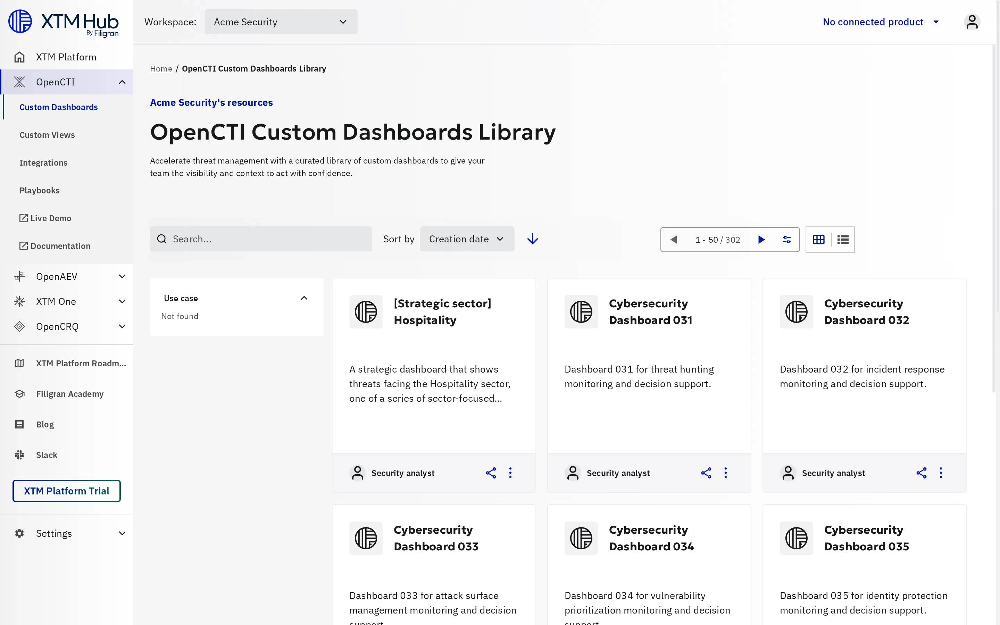
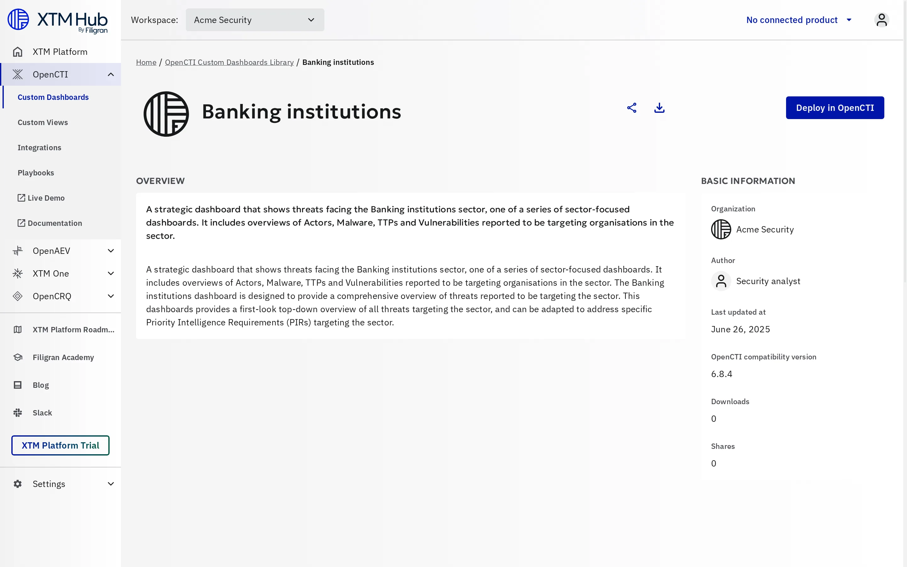
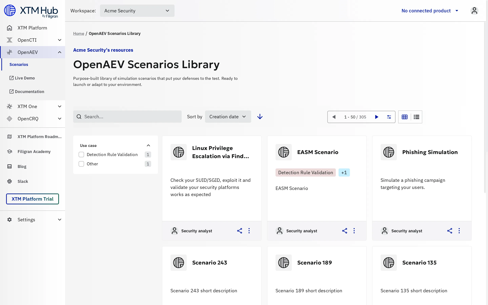
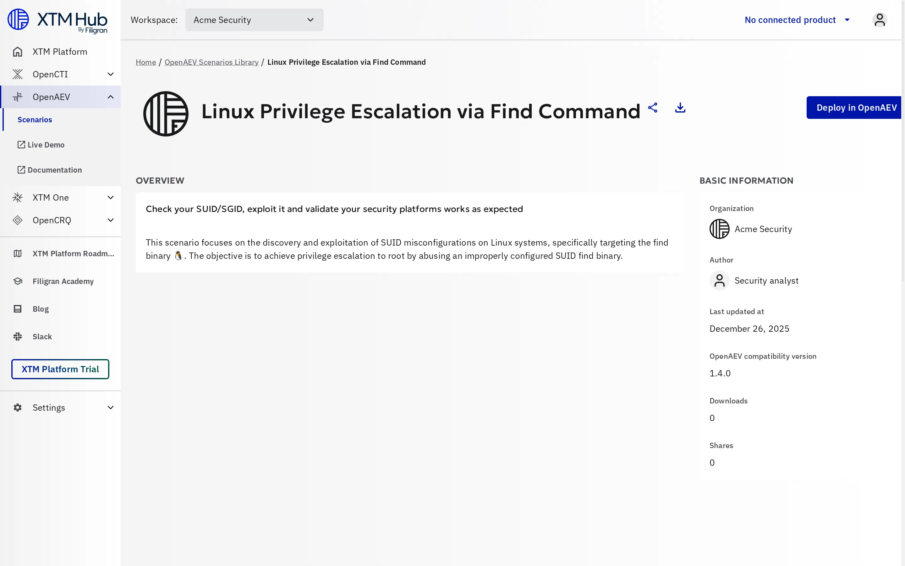
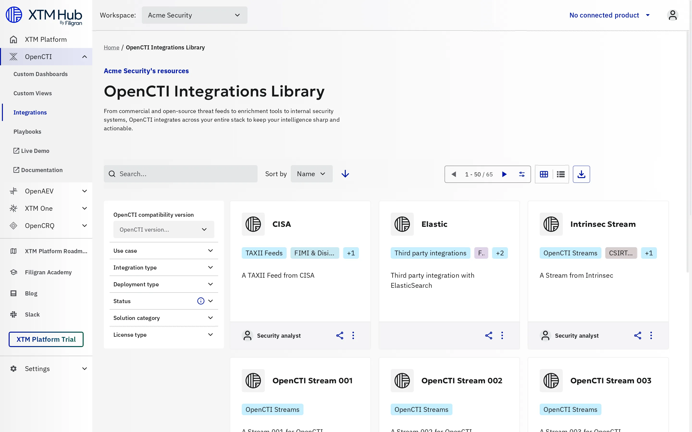
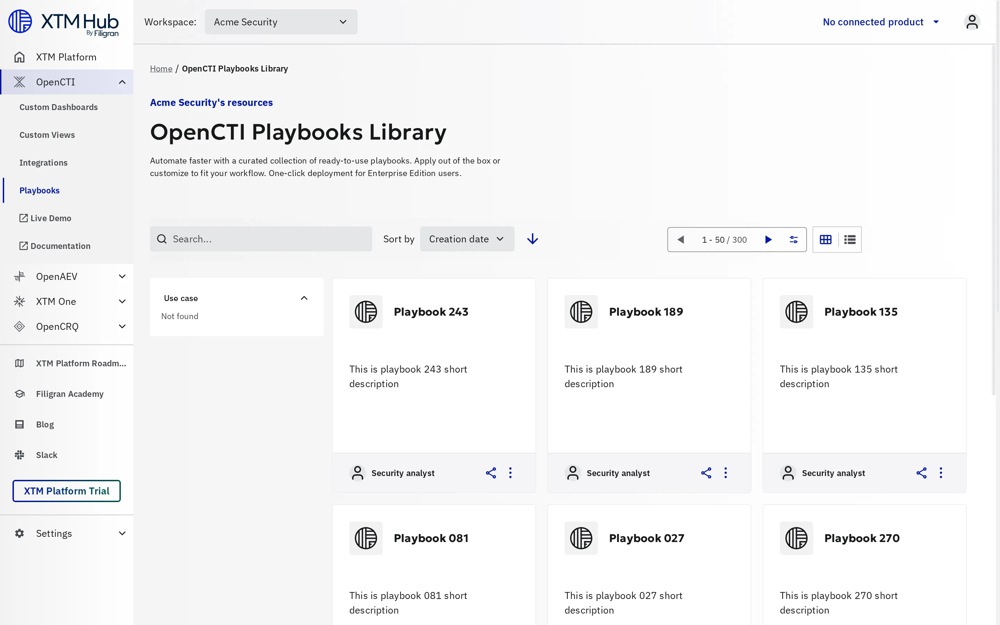
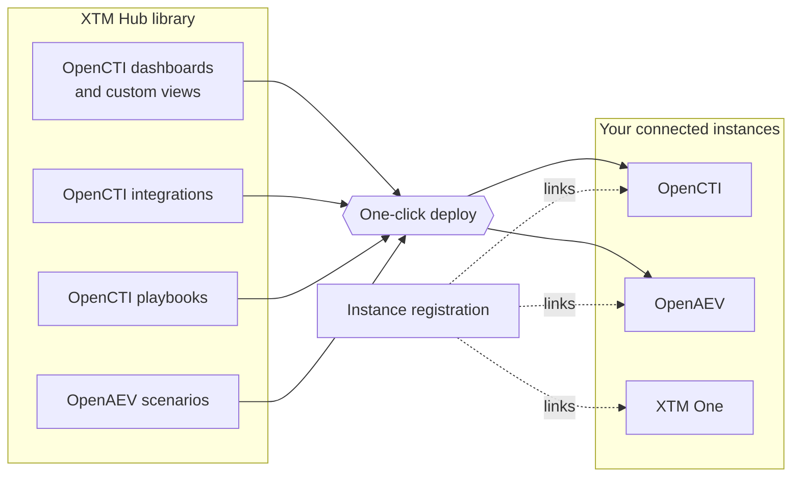
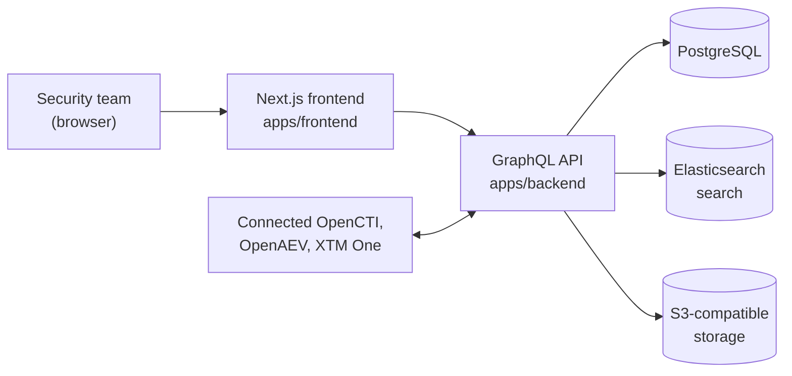
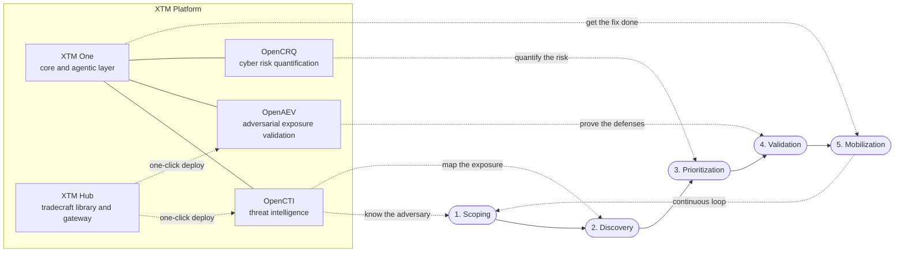

<h1 align="center">
  <a href="https://hub.filigran.io"></a>
</h1>
<p align="center">
  <a href="https://github.com/XTM-Hub/xtm-hub/stargazers"></a>
  <a href="https://github.com/XTM-Hub/xtm-hub/releases"></a>
  <a href="./LICENSE"></a>
  <a href="https://docs.hub.filigran.io"></a>
  <a href="https://community.filigran.io"></a>
</p>

<p align="center"><b>The tradecraft library and gateway of the XTM Platform: CTEM content you deploy in one click into your own OpenCTI and OpenAEV.</b></p>

[XTM Hub](https://hub.filigran.io) gives security teams ready-made tradecraft for Continuous Threat Exposure Management (CTEM): [OpenCTI](https://github.com/OpenCTI-Platform/opencti) dashboards, custom views, integrations and playbooks to know the adversary and map the exposure, and [OpenAEV](https://github.com/OpenAEV-Platform/openaev) scenarios to prove your defenses against real attacker techniques. Connect your instance once, then deploy any resource into it in one click instead of rebuilding it by hand.

> If XTM Hub or the [XTM Platform](https://filigran.io) helps your team, **star this repository**. It is the simplest way to help the project reach more defenders.

<p align="center">
  <picture>
    <source media="(prefers-color-scheme: dark)" srcset="./.github/img/hub-home-dark.webp">
    
  </picture>
</p>

## Table of contents

- [Why XTM Hub](#why-xtm-hub)
- [Capabilities](#capabilities)
- [Gallery](#gallery)
- [How it works](#how-it-works)
- [Part of the XTM Platform](#part-of-the-xtm-platform)
- [Quick start](#quick-start)
- [Editions](#editions)
- [Integrations and ecosystem](#integrations-and-ecosystem)
- [Community](#community)
- [Contributing](#contributing)
- [Security](#security)
- [License](#license)
- [About Filigran](#about-filigran)

## Why XTM Hub

A CTEM program runs on tradecraft: the dashboards that scope the threats against your sector, the integrations that feed your threat intelligence, the playbooks that automate triage and the attack scenarios that validate your controls. Each one takes days to build, and most teams rebuild what another team already got right. XTM Hub turns that tradecraft into a shared library, curated and searchable, that lands in your own instance in one click.

## Capabilities

| CTEM stage | What XTM Hub gives the security team |
| --- | --- |
| **Scoping** | OpenCTI custom dashboards for sectors and threat topics: the actors, malware, techniques and vulnerabilities that target organizations like yours. |
| **Discovery** | OpenCTI integrations (threat feeds, enrichment, third-party security tools), filtered by use case, integration type, deployment type and license, to bring new sources into your intelligence. |
| **Prioritization** | OpenCTI custom views that put the threats and exposures that matter in front of each analyst. |
| **Validation** | OpenAEV scenarios by category: atomic testing, attack simulation, penetration testing, platform validation, purple team, tabletop exercises, OpenCTI coverage and the CTEM framework. |
| **Mobilization** | OpenCTI playbooks that automate triage and response. One-click deployment of playbooks needs OpenCTI Enterprise Edition. |
| **Every stage** | One-click deploy into a connected instance, instance registration for OpenCTI, OpenAEV and XTM One, the public XTM Platform roadmap with feature voting, and personal API tokens (read, read and write, admin) with a lifetime for your scripts and pipelines. |

Use cases: CTI teams start from sector dashboards and curated feeds; SOC and detection engineers add enrichment and playbooks; red and purple teams run ready-made attack scenarios; vulnerability and exposure management teams test the techniques that reach their assets; CISOs share one library across every instance they run.

## Gallery

<table>
  <tr>
    <td width="50%">
      <picture>
        <source media="(prefers-color-scheme: dark)" srcset="./.github/img/hub-dashboards-dark.webp">
        
      </picture>
      <p align="center"><b>Dashboards library</b>: start from sector and threat dashboards instead of an empty OpenCTI workspace.</p>
    </td>
    <td width="50%">
      <picture>
        <source media="(prefers-color-scheme: dark)" srcset="./.github/img/hub-dashboard-detail-dark.webp">
        
      </picture>
      <p align="center"><b>One-click deploy</b>: read what a dashboard shows, then send it to your OpenCTI.</p>
    </td>
  </tr>
  <tr>
    <td width="50%">
      <picture>
        <source media="(prefers-color-scheme: dark)" srcset="./.github/img/hub-scenarios-dark.webp">
        
      </picture>
      <p align="center"><b>Scenarios library</b>: attack scenarios by category to validate your controls.</p>
    </td>
    <td width="50%">
      <picture>
        <source media="(prefers-color-scheme: dark)" srcset="./.github/img/hub-scenario-detail-dark.webp">
        
      </picture>
      <p align="center"><b>Scenario detail</b>: the objective and compatibility of a test before you run it in OpenAEV.</p>
    </td>
  </tr>
  <tr>
    <td width="50%">
      <picture>
        <source media="(prefers-color-scheme: dark)" srcset="./.github/img/hub-integrations-dark.webp">
        
      </picture>
      <p align="center"><b>Integrations catalog</b>: find the feed or enrichment that fills a gap in your intelligence.</p>
    </td>
    <td width="50%">
      <picture>
        <source media="(prefers-color-scheme: dark)" srcset="./.github/img/hub-playbooks-dark.webp">
        
      </picture>
      <p align="center"><b>Playbooks library</b>: automation you apply as is or adapt to your workflow.</p>
    </td>
  </tr>
  <tr>
    <td colspan="2">
      <picture>
        <source media="(prefers-color-scheme: dark)" srcset="./.github/img/hub-connect-dark.webp">
        
      </picture>
      <p align="center"><b>Connect an instance</b>: register your OpenCTI or OpenAEV once, and every later deployment is one click.</p>
    </td>
  </tr>
</table>

## How it works

XTM Hub serves curated content to the instances you connect. Registration links an OpenCTI, OpenAEV or XTM One instance to your organization in the Hub; a deployment sends the resource straight to the instance you pick, with no export, no file to move and no manual import.



Under the hood, XTM Hub is a TypeScript monorepo: a GraphQL API (`apps/backend`: Express, Apollo Server, PostgreSQL, Elasticsearch, S3-compatible storage) and a Next.js web application (`apps/frontend`).



## Part of the XTM Platform

XTM Hub is one of the five products of the [XTM Platform](https://filigran.io), the open platform for Agentic CTEM.



| Product | What it does for a CTEM program |
| --- | --- |
| [XTM One](https://github.com/XTM-One-Platform/xtm-one) | The core and agentic layer that runs CTEM across the modules ([product page](https://filigran.io/products/xtm-one)) |
| [OpenCTI](https://github.com/OpenCTI-Platform/opencti) | Threat intelligence: know the adversary and the threats that target you ([product page](https://filigran.io/products/opencti)) |
| [OpenAEV](https://github.com/OpenAEV-Platform/openaev) | Adversarial exposure validation: prove your defenses against real attacker techniques ([product page](https://filigran.io/products/openaev)) |
| [OpenCRQ](https://filigran.io/products/opencrq) | Cyber risk quantification: turn exposure into financial risk |
| [XTM Hub](https://hub.filigran.io) | The tradecraft library and gateway for all of them ([product page](https://filigran.io/platforms/xtm-hub/)) |

## Quick start

**Use it**: XTM Hub runs as a service at [hub.filigran.io](https://hub.filigran.io). Sign in, open a library, and connect your instance from the first deployment. The [documentation](https://docs.hub.filigran.io) covers registration, deployment and API tokens.

**Run it locally**: the Node version comes from [`.nvmrc`](.nvmrc) and the Yarn version from `packageManager` in [`package.json`](package.json).

```bash
corepack enable                                       # required before any yarn command
yarn install                                          # installs every workspace
docker compose -f xtm-hub-dev/docker-compose.yml up   # PostgreSQL, S3 storage, Elasticsearch, Kibana, Mailpit
yarn dev:api                                          # GraphQL API on http://localhost:4002
yarn dev:front                                        # web application on http://localhost:3002, start the API first
```

In development the backend seeds sample library content, so the libraries are not empty on first start. Validation commands and the coding rules of each area are in [AGENTS.md](AGENTS.md). The Helm chart used to deploy the Hub is in [`chart/`](chart).

## Editions

XTM Hub is free to use at [hub.filigran.io](https://hub.filigran.io). Its source code is available under the terms of the [LICENSE](LICENSE): you may read it, fork it for personal or educational use, and contribute through issues and pull requests; production and commercial use are not permitted. Some content depends on the edition of the product it deploys to: one-click deployment of playbooks needs OpenCTI Enterprise Edition.

## Integrations and ecosystem

- **Libraries**: [OpenCTI dashboards, custom views, integrations and playbooks, OpenAEV scenarios](https://hub.filigran.io) in one place.
- **Products**: [OpenCTI](https://github.com/OpenCTI-Platform/opencti), [OpenAEV](https://github.com/OpenAEV-Platform/openaev) and [XTM One](https://github.com/XTM-One-Platform/xtm-one) register with the Hub; [OpenCTI connectors](https://github.com/OpenCTI-Platform/connectors) are listed in the integrations catalog.
- **Learn**: [Filigran Academy](https://academy.filigran.io) courses for OpenCTI and OpenAEV, and the [Filigran blog](https://filigran.io/blog).

## Community

- Like the project? [Star XTM Hub](https://github.com/XTM-Hub/xtm-hub/stargazers) and the other XTM Platform repositories.
- Report a bug or ask for a feature in [GitHub issues](https://github.com/XTM-Hub/xtm-hub/issues).
- Vote on the [XTM Platform roadmap](https://hub.filigran.io) in the Hub.
- Join the discussion on the [Filigran community Slack](https://community.filigran.io).

<a href="https://star-history.com/#XTM-Hub/xtm-hub&Date">
  <picture>
    <source media="(prefers-color-scheme: dark)" srcset="https://api.star-history.com/svg?repos=XTM-Hub/xtm-hub&type=Date&theme=dark">
    
  </picture>
</a>

<a href="https://github.com/XTM-Hub/xtm-hub/graphs/contributors"></a>

## Contributing

- Read the [contributing guide](CONTRIBUTING.md) and the [code of conduct](CODE_OF_CONDUCT.md).
- New to the codebase? Start with the [good first issues](https://github.com/XTM-Hub/xtm-hub/issues?q=is%3Aissue%20state%3Aopen%20label%3A%22good%20first%20issue%22).
- Pull request titles follow Conventional Commits and end with the issue they close, for example `fix(frontend): keep the filter on reload (#123)`. Commits are signed.

## Security

Please do not report a security vulnerability in a public issue. Send it to [contact@filigran.io](mailto:contact@filigran.io) with a description, the affected version and the steps to reproduce.

## License

XTM Hub is source available. See [LICENSE](LICENSE) for the full terms.

## About Filigran

[Filigran](https://filigran.io) builds the XTM Platform, the open platform for Agentic CTEM, with XTM One, OpenCTI, OpenAEV, OpenCRQ and XTM Hub.

<a href="https://filigran.io"></a>
