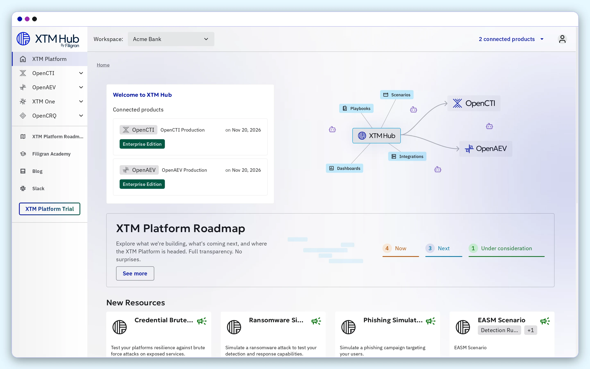
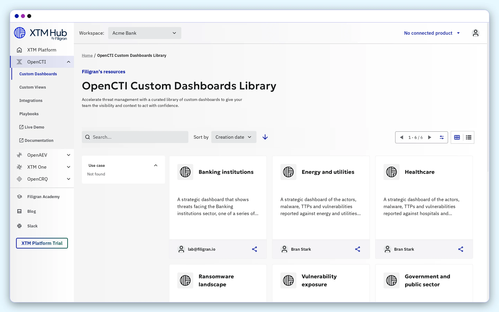
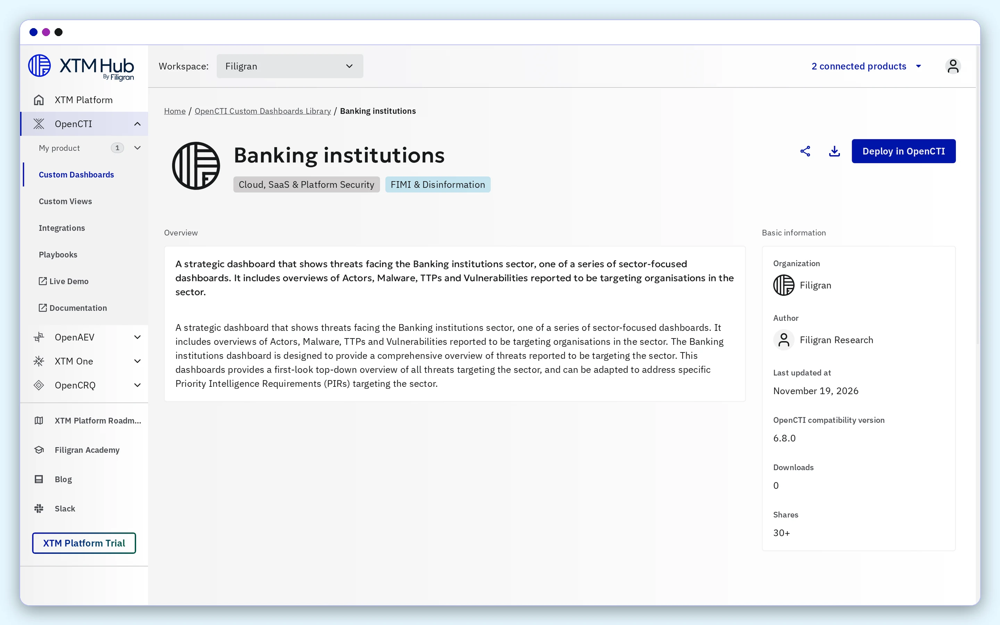
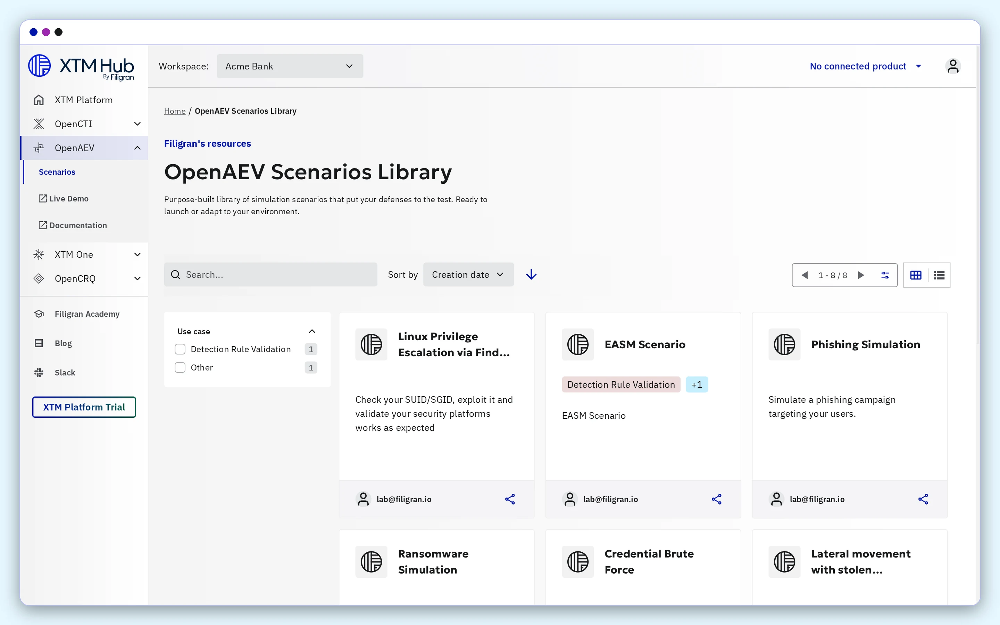
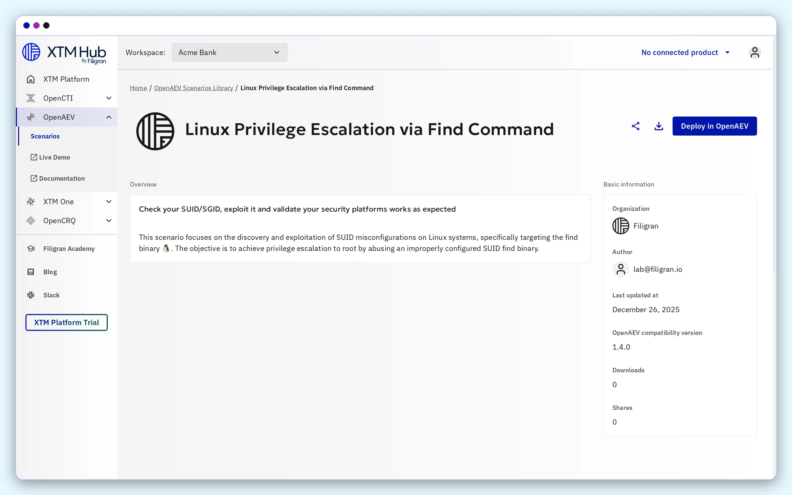
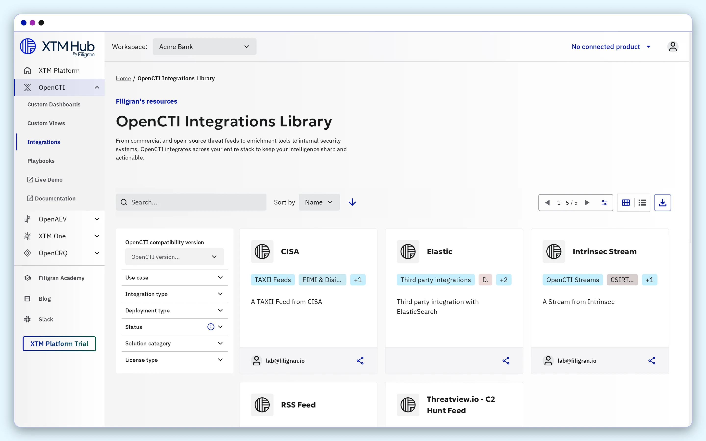
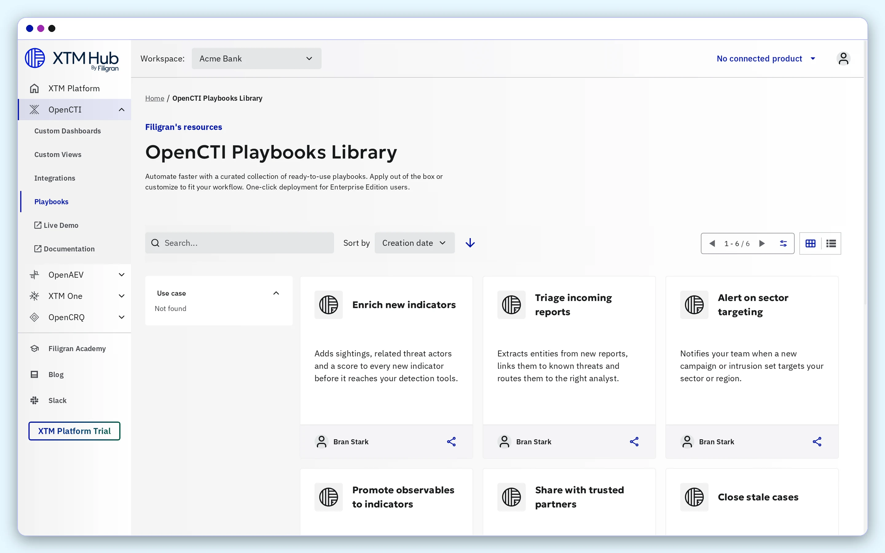
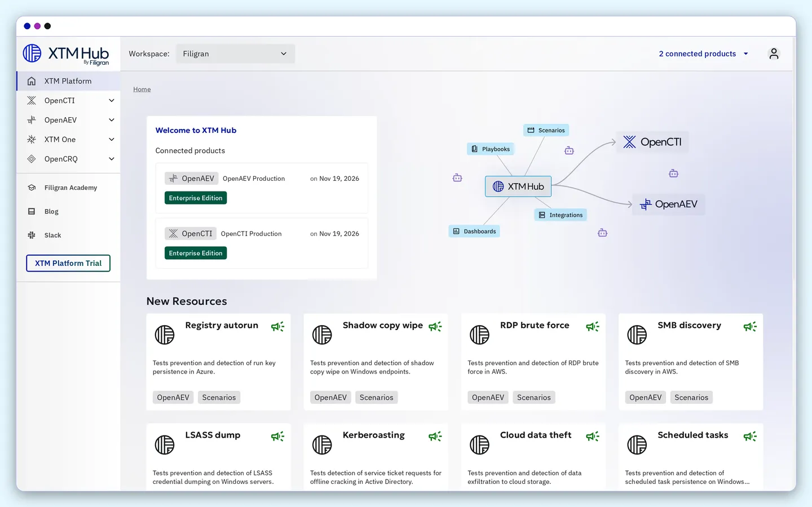
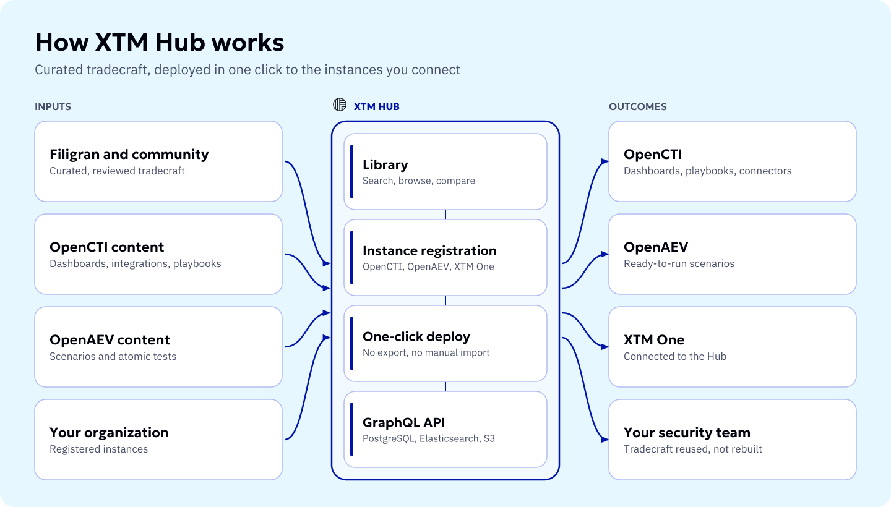
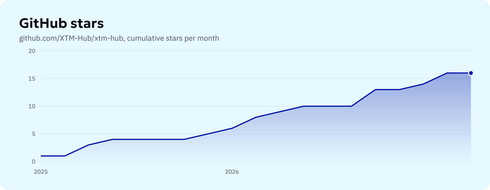

<a href="https://filigran.io/platforms/xtm-hub/"></a>

<p align="center">
  <a href="https://github.com/XTM-Hub/xtm-hub/stargazers"></a>
  <a href="https://github.com/XTM-Hub/xtm-hub/releases/latest"></a>
  <a href="LICENSE"></a>
  <a href="https://docs.hub.filigran.io"></a>
  <a href="https://community.filigran.io"></a>
</p>

<p align="center"><b>The tradecraft library and gateway of the XTM Platform: CTEM content you deploy in one click into your own OpenCTI and OpenAEV.</b></p>

[XTM Hub](https://hub.filigran.io) gives security teams ready-made tradecraft for Continuous Threat Exposure Management (CTEM): [OpenCTI](https://github.com/OpenCTI-Platform/opencti) dashboards, custom views, integrations and playbooks to know the adversary and map the exposure, and [OpenAEV](https://github.com/OpenAEV-Platform/openaev) scenarios to prove your defenses against real attacker techniques. Connect your instance once, then deploy any resource into it in one click.

<p align="center">If XTM Hub helps your security program, <a href="https://github.com/XTM-Hub/xtm-hub/stargazers">give it a star</a>: it is how the project grows.</p>

<picture>
  <source media="(prefers-color-scheme: dark)" srcset="./.github/img/readme/hero-dark.webp">
  <source media="(prefers-color-scheme: light)" srcset="./.github/img/readme/hero-light.webp">
  
</picture>

## Table of contents

- [Why XTM Hub](#why-xtm-hub)
- [Capabilities](#capabilities)
- [Gallery](#gallery)
- [How it works](#how-it-works)
- [Part of the XTM Platform](#part-of-the-xtm-platform)
- [Use cases by security role](#use-cases-by-security-role)
- [Quick start](#quick-start)
- [Editions](#editions)
- [Integrations and ecosystem](#integrations-and-ecosystem)
- [Community](#community)
- [Contributing](#contributing)
- [Security](#security)
- [License](#license)
- [About Filigran](#about-filigran)

## Why XTM Hub

A CTEM program runs on tradecraft: dashboards, integrations, playbooks and attack scenarios. Each one takes days to build, and most teams rebuild what another team already got right.

- **A shared library, curated.** Dashboards, custom views, integrations, playbooks and scenarios, searchable by use case, type and compatibility.
- **One click to your instance.** A deployment sends the resource straight to the OpenCTI or OpenAEV you pick, with no export, no file to move and no manual import.
- **One gateway for the platform.** Instance registration for OpenCTI, OpenAEV and XTM One, the public roadmap with feature voting and personal API tokens.

## Capabilities

| CTEM stage | What XTM Hub gives your team |
|---|---|
| **Scoping** | OpenCTI custom dashboards for sectors and threat topics: the actors, malware, techniques and vulnerabilities that target organizations like yours. |
| **Discovery** | OpenCTI integrations (threat feeds, enrichment, third-party tools), filtered by use case, integration type, deployment type and license. |
| **Prioritization** | OpenCTI custom views that put the threats and exposures that matter in front of each analyst. |
| **Validation** | OpenAEV scenarios by category: atomic testing, attack simulation, purple team, tabletop exercises, OpenCTI coverage and the CTEM framework. |
| **Mobilization** | OpenCTI playbooks that automate triage and response, deployed in one click to OpenCTI Enterprise Edition. |

## Gallery

<table>
  <tr>
    <td width="50%" valign="top">
      <picture>
        <source media="(prefers-color-scheme: dark)" srcset="./.github/img/readme/g1-dark.webp">
        <source media="(prefers-color-scheme: light)" srcset="./.github/img/readme/g1-light.webp">
        
      </picture>
      <p><b>Dashboards library.</b> Start from sector and threat dashboards instead of an empty workspace.</p>
    </td>
    <td width="50%" valign="top">
      <picture>
        <source media="(prefers-color-scheme: dark)" srcset="./.github/img/readme/g2-dark.webp">
        <source media="(prefers-color-scheme: light)" srcset="./.github/img/readme/g2-light.webp">
        
      </picture>
      <p><b>One-click deploy.</b> Read what a dashboard shows, then send it to your OpenCTI.</p>
    </td>
  </tr>
  <tr>
    <td width="50%" valign="top">
      <picture>
        <source media="(prefers-color-scheme: dark)" srcset="./.github/img/readme/g3-dark.webp">
        <source media="(prefers-color-scheme: light)" srcset="./.github/img/readme/g3-light.webp">
        
      </picture>
      <p><b>Scenarios library.</b> Attack scenarios by category to validate your controls in OpenAEV.</p>
    </td>
    <td width="50%" valign="top">
      <picture>
        <source media="(prefers-color-scheme: dark)" srcset="./.github/img/readme/g4-dark.webp">
        <source media="(prefers-color-scheme: light)" srcset="./.github/img/readme/g4-light.webp">
        
      </picture>
      <p><b>Scenario detail.</b> The objective and compatibility of a test before you run it.</p>
    </td>
  </tr>
  <tr>
    <td width="50%" valign="top">
      <picture>
        <source media="(prefers-color-scheme: dark)" srcset="./.github/img/readme/g5-dark.webp">
        <source media="(prefers-color-scheme: light)" srcset="./.github/img/readme/g5-light.webp">
        
      </picture>
      <p><b>Integrations catalog.</b> Find the feed or enrichment that fills a gap in your intelligence.</p>
    </td>
    <td width="50%" valign="top">
      <picture>
        <source media="(prefers-color-scheme: dark)" srcset="./.github/img/readme/g6-dark.webp">
        <source media="(prefers-color-scheme: light)" srcset="./.github/img/readme/g6-light.webp">
        
      </picture>
      <p><b>Playbooks library.</b> Automation you apply as is or adapt to your workflow.</p>
    </td>
  </tr>
</table>

**Walkthrough.** From the library to a dashboard deployed in your OpenCTI, in 15 seconds.

<picture>
  <source media="(prefers-color-scheme: dark)" srcset="./.github/img/readme/walkthrough-dark.webp">
  <source media="(prefers-color-scheme: light)" srcset="./.github/img/readme/walkthrough-light.webp">
  
</picture>

## How it works

XTM Hub serves curated content to the instances you connect. Registration links an OpenCTI, OpenAEV or XTM One instance to your organization; a deployment sends the resource straight to the instance you pick. Under the hood: a GraphQL API (Express, Apollo Server, PostgreSQL, Elasticsearch, S3-compatible storage) and a Next.js web application, in one TypeScript monorepo.

<picture>
  <source media="(prefers-color-scheme: dark)" srcset="./.github/img/readme/flow-dark.svg">
  <source media="(prefers-color-scheme: light)" srcset="./.github/img/readme/flow-light.svg">
  
</picture>

## Part of the XTM Platform

XTM Hub is one of the five products of the [XTM Platform](https://filigran.io), the open platform for Agentic CTEM. Each product owns stages of the CTEM loop; XTM One runs the loop across them.

<picture>
  <source media="(prefers-color-scheme: dark)" srcset="./.github/img/readme/xtm-platform-ctem-dark.svg">
  <source media="(prefers-color-scheme: light)" srcset="./.github/img/readme/xtm-platform-ctem-light.svg">
  
</picture>

| | Product | Role in CTEM | Repository | Product page |
|---|---|---|---|---|
| <picture><source media="(prefers-color-scheme: dark)" srcset="./.github/img/readme/mark-xtm-one-dark.svg"></picture> | **XTM One** | Core and agentic layer: runs CTEM across the modules and gets the fix done | [XTM-One-Platform/xtm-one](https://github.com/XTM-One-Platform/xtm-one) | [filigran.io/products/xtm-one](https://filigran.io/products/xtm-one) |
| <picture><source media="(prefers-color-scheme: dark)" srcset="./.github/img/readme/mark-opencti-dark.svg"></picture> | **OpenCTI** | Scoping and Discovery: know the adversary and the threats that target you | [OpenCTI-Platform/opencti](https://github.com/OpenCTI-Platform/opencti) | [filigran.io/products/opencti](https://filigran.io/products/opencti) |
| <picture><source media="(prefers-color-scheme: dark)" srcset="./.github/img/readme/mark-opencrq-dark.svg"></picture> | **OpenCRQ** | Prioritization: turn exposure into financial risk | [OpenCRQ-Platform/opencrq](https://github.com/OpenCRQ-Platform/opencrq) | [filigran.io/products/opencrq](https://filigran.io/products/opencrq) |
| <picture><source media="(prefers-color-scheme: dark)" srcset="./.github/img/readme/mark-openaev-dark.svg"></picture> | **OpenAEV** | Validation: prove your defenses against real attacker techniques | [OpenAEV-Platform/openaev](https://github.com/OpenAEV-Platform/openaev) | [filigran.io/products/openaev](https://filigran.io/products/openaev) |
| <picture><source media="(prefers-color-scheme: dark)" srcset="./.github/img/readme/mark-xtm-hub-dark.svg"></picture> | **XTM Hub** | Tradecraft library and gateway: integrations, dashboards and scenarios for every product | [XTM-Hub/xtm-hub](https://github.com/XTM-Hub/xtm-hub) | [filigran.io/platforms/xtm-hub](https://filigran.io/platforms/xtm-hub/) |

## Use cases by security role

| Role | What XTM Hub does for it |
|---|---|
| **CTI** | Sector dashboards and curated feeds to start from, deployed into OpenCTI in one click. |
| **SOC** | Enrichment integrations and custom views that put the alerts that matter in front of each analyst. |
| **Detection engineering** | Playbooks and integrations that route intelligence to the detection stack. |
| **Red and purple team** | Ready-made OpenAEV attack scenarios by category, from atomic tests to purple team exercises. |
| **Vulnerability and exposure management** | Scenarios that test the techniques that reach your assets and dashboards on the vulnerabilities exploited in the wild. |
| **Risk and CISO** | One library shared across every instance you run, and the public XTM Platform roadmap. |

## Quick start

**Use it**: XTM Hub runs as a service at [hub.filigran.io](https://hub.filigran.io). Sign in, open a library and connect your instance from the first deployment.

**Run it locally**: Node from [`.nvmrc`](.nvmrc) and Yarn from `packageManager` in [`package.json`](package.json).

```bash
corepack enable && yarn install
docker compose -f xtm-hub-dev/docker-compose.yml up -d   # PostgreSQL, S3, Elasticsearch, Mailpit
yarn dev:api && yarn dev:front                           # API on :4002, web application on :3002
```

- **Docs**: [registration, deployment and API tokens](https://docs.hub.filigran.io).
- **Helm**: the chart used to deploy the Hub is in [`chart/`](chart).
- **Contributors**: validation commands and coding rules in [AGENTS.md](AGENTS.md).

## Editions

| | Free service | Source code |
|---|---|---|
| License | [hub.filigran.io](https://hub.filigran.io) terms | [Source available](LICENSE) |
| Libraries, one-click deploy, registration, roadmap | Yes | Read, fork for personal use |
| Production and commercial use of the code | | Not permitted |

Some content depends on the edition of the product it deploys to: one-click deployment of playbooks needs OpenCTI Enterprise Edition.

## Integrations and ecosystem

- **XTM Platform:** OpenCTI, OpenAEV and XTM One register with the Hub and receive its content in one click.
- **[Libraries](https://hub.filigran.io):** OpenCTI dashboards, custom views, integrations and playbooks, and OpenAEV scenarios in one place.
- **Connectors:** the [OpenCTI connectors](https://github.com/OpenCTI-Platform/connectors) are listed in the integrations catalog.
- **API:** personal API tokens (read, read and write, admin) with a lifetime for your scripts and pipelines.

## Community

Star XTM Hub to follow it and to help other security teams find it.

<picture>
  <source media="(prefers-color-scheme: dark)" srcset="./.github/img/readme/stars-dark.svg">
  <source media="(prefers-color-scheme: light)" srcset="./.github/img/readme/stars-light.svg">
  
</picture>

- **Questions and discussion**: the Filigran [community Slack](https://community.filigran.io).
- **Bugs and feature requests**: [GitHub issues](https://github.com/XTM-Hub/xtm-hub/issues).
- **Learn**: free courses on [Filigran Academy](https://academy.filigran.io).

## Contributing

Read the [contributing guide](CONTRIBUTING.md) to set up a development environment and propose a change. XTM Hub has adopted a [Code of Conduct](CODE_OF_CONDUCT.md). First contribution: the [good first issues](https://github.com/XTM-Hub/xtm-hub/labels/good%20first%20issue).

## Security

Report vulnerabilities privately as described in [SECURITY.md](SECURITY.md), never in a public issue.

## License

XTM Hub is source available under the terms of [LICENSE](LICENSE).

## About Filigran

XTM Hub is designed and developed by [Filigran](https://filigran.io), the company behind the [XTM Platform](https://filigran.io) for Agentic CTEM.

<picture>
  <source media="(prefers-color-scheme: dark)" srcset="./.github/img/readme/filigran-dark.svg">
  <source media="(prefers-color-scheme: light)" srcset="./.github/img/readme/filigran-light.svg">
  
</picture>
