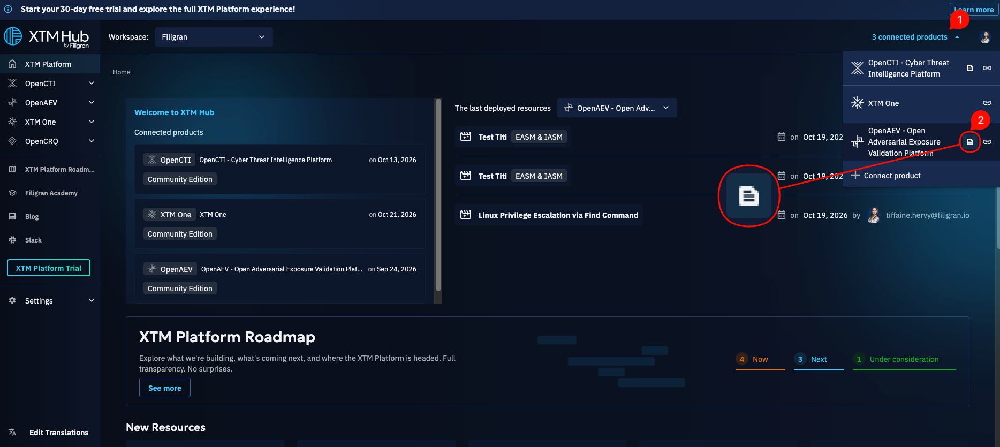
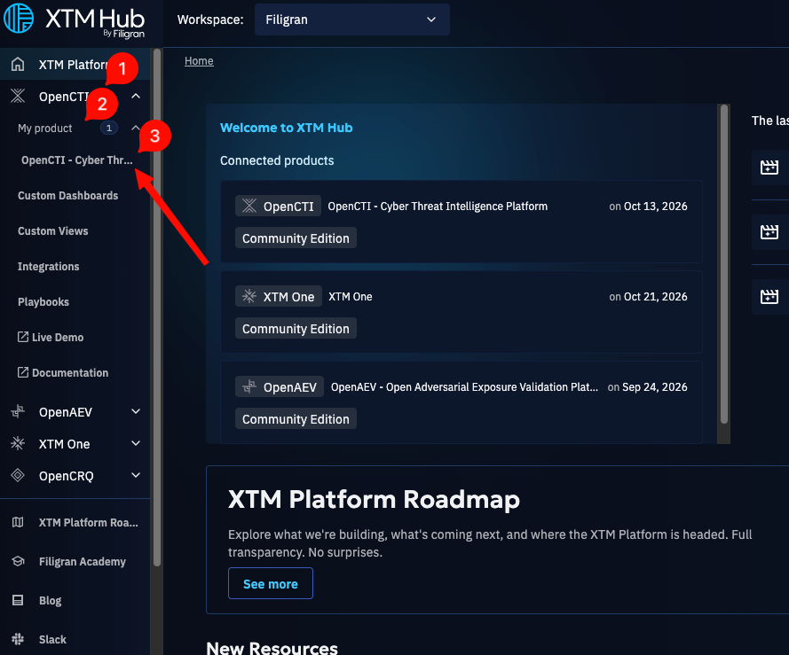
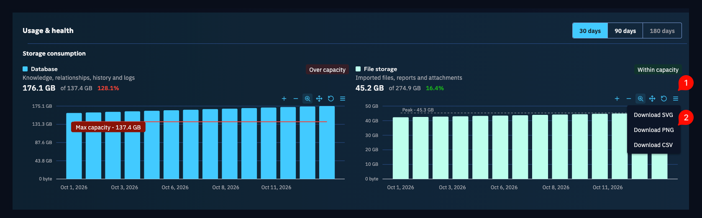
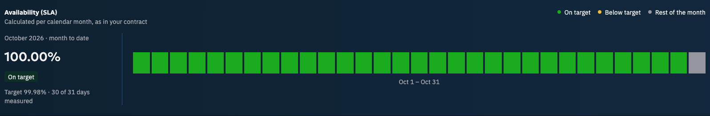
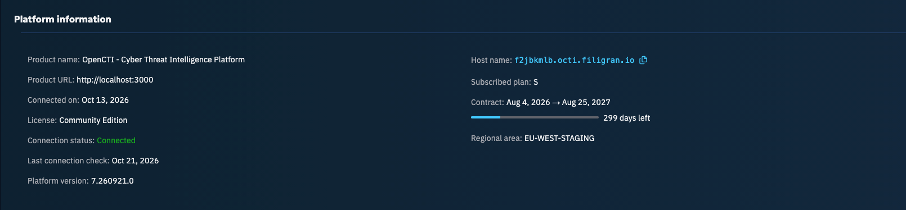

# OpenCTI Product Connection

To utilize features such as one-click deployments, your OpenCTI product must be connected (available from OpenCTI
6.7.10).

The connection process is initiated from your OpenCTI product. For more detailed information, please refer to
the [OpenCTI documentation](https://docs.opencti.io/latest/administration/hub). You can also connect your product from
several places in XTM Hub:

- From the header in the top right corner, click on "X connected products" and then click "Connect your product +"

- From the homepage if you do not have any product connected, click on the blue button "Connect your product +"

- From libraries: when you try a one-click deployment without a connected product, you can connect one directly from
  there.

To connect from Hub, you just need your product URL, XTM Hub takes care of the rest!

## View a list of your connected OpenCTI products

You can access a list of your connected OpenCTI products on the homepage.

To locate a specific product, look under the organization where it was initially connected. You will see a tile on the
homepage you can click to access the newly connected product.

You can also have access to your connected products anywhere from the header in the top right corner.

The product's name is derived directly from the title of your OpenCTI product. You can edit it on the product's page on
XTM Hub or during the connection process.

## View your product's metrics (SaaS customers)

This feature is only available to SaaS customers. Your product's details page shows data about its usage and health. To
open it, click "X connected products" in the header, then click the details icon next to your product.

You can also open it from the side menu: expand your product's section, then "My product", and select your product.

### Header

From the page header, you can open your product, rename it or disconnect it. The header also shows the product's name,
license and connection status.

### Usage and health

Use the "30 days", "90 days" and "180 days" buttons at the top of the section to change the period the graphs cover.

#### Storage consumption

The first graph shows how much of the database (Elasticsearch) your product uses, compared to what your plan allows. The
second one shows the file storage (S3), which holds your imported files, reports and attachments.

Both graphs show one bar per day: hover over a bar to see that day's consumption. You can download each graph as SVG,
PNG or CSV from its menu.

#### Availability (SLA)

This graph shows your product's availability against the target set in your contract: 99.98%. Each day has its own bar,
green when the availability meets the target and amber when it falls below. The monthly average is on the left of the
graph. As the availability is calculated per calendar month, the graph only has a few bars at the beginning of a month.

Availability has been measured since September 9, 2026: there is no data before that date.

### Platform information

This section gives details about your product, such as its host name, subscribed plan, contract dates, platform version
and regional area. Its outbound IP address will be added soon.

