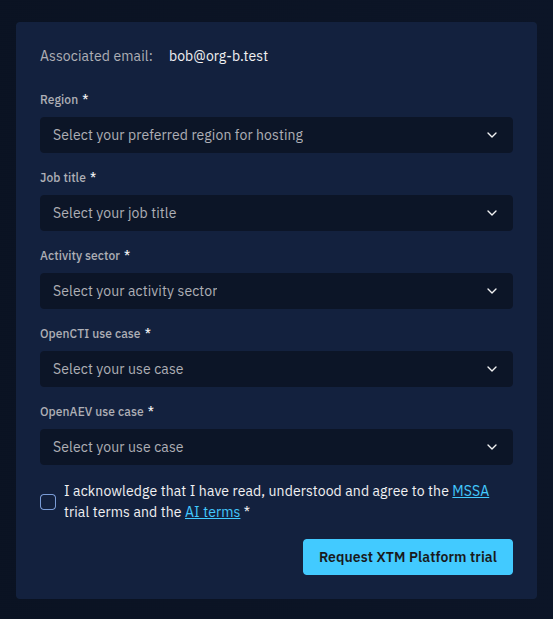
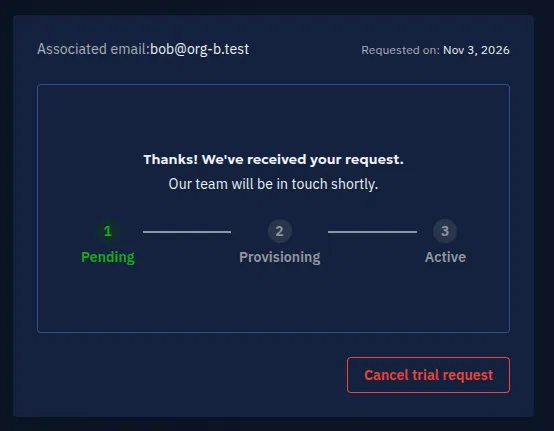
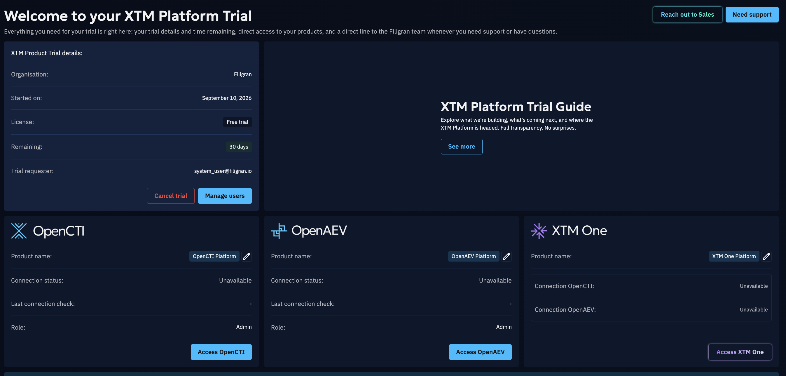
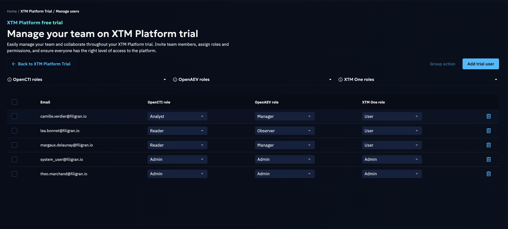

# XTM Platform Trial

The XTM Platform Trial gives your organization **30 days** of access to the Enterprise Edition of
**XTM One**, **OpenCTI** and **OpenAEV**. Every trial includes all three products: you do not choose them.

All three products are provisioned and managed from a single page in the XTM Hub, and your team members
sign in to them with their XTM Hub credentials.

## Request a Trial

To request a trial you must:

- be logged in to the XTM Hub,
- have an organization selected — trials are not available in a
  [personal space](manage-organization.md#personal-space),
- have the **ADMINISTRATE ORGANIZATION** or **MANAGE PLATFORM REGISTRATION**
  [capability](manage-organization.md#available-capabilities) in that organization.

If you do not have the required capability, contact your organization's administrator.

### To Request a Trial

1. Open the main menu.
2. Click **XTM Platform Trial**.
3. Select the **Region** that will host your products: Europe West, United States East, Australia or
   Singapore.
4. Select your **Job title** and **Activity sector**, then an **OpenCTI use case** and an **OpenAEV use
   case**. XTM One does not need one.
5. Read and accept the [Master Software Subscription Agreement](https://filigran.io/mssa) and the
   [AI terms of use](https://filigran.io/ai-terms).
6. Click **Request XTM Platform trial**.

All fields are required.

If the selected region has no free slot, your request is placed on a waiting list and starts as soon as a
slot becomes available.

### Rules

- Each organization can have only one trial.
- If you cancel your request before the trial is active, your organization can request a new trial.
  See [Cancellation](#cancellation).

## Trial Statuses

While your request is in progress, the XTM Platform Trial page shows the date of the request and its
progress in three steps:

| Step         | Description                                                                              |
|--------------|------------------------------------------------------------------------------------------|
| Pending      | Your request has been received and is waiting to be deployed, or is on the waiting list. |
| Provisioning | Your products are being provisioned.                                                     |
| Active       | Your trial has started. The page now shows your trial details and your products.         |

A trial that has ended shows one of these states:

| Status    | Description                                                                        |
|-----------|------------------------------------------------------------------------------------|
| Cancelled | The trial has been cancelled. Your organization cannot request a new one.          |
| Expired   | The trial period has ended and access is no longer active.                         |
| Failed    | The provisioning failed for technical reasons.                                     |

From these states, use **Reach out to Sales** to contact our Sales team.

## Trial Duration and Expiration

All trials last **30 days**. The start date and the number of remaining days are displayed on the
XTM Platform Trial page.

When the trial expires, access to all three products ends and the platforms are de-provisioned. To keep
using the Enterprise Edition, contact our Sales team.

## Enterprise License

The trial comes with an EE license, with all the Enterprise Edition features of the three products:

- [OpenCTI Enterprise Documentation](https://docs.opencti.io/latest/administration/enterprise/?h=edition)
- [OpenAEV Enterprise Documentation](https://docs.openaev.io/latest/administration/enterprise/?h=enterprise)
- [XTM One Editions and Licensing](https://docs.xtmone.io/latest/administration/editions-and-licensing/)

## Trial Limitations

Your trial products include all the features of the Enterprise Edition SaaS offering, but run on
limited compute and storage resources:

- **OpenCTI**: up to 40 GB of intelligence data and 3 GB of file storage.
- **OpenAEV**: up to 16 GB of storage.

Large premium feeds can fill this storage quickly. The trial comes with **no SLA**: recovery time is
not guaranteed, so do not store critical data on your trial products.

## Your Trial Page

Once the trial is active, the XTM Platform Trial page gathers everything about it:

- **Trial details**: organization, start date, license, remaining days and the email of the user who
  requested the trial.
- **One card per product**: its name, its connection status and the date of the last connection check,
  the role you have been granted on it, and an **Access** button to open it. You can rename a product
  from its card. The XTM One card shows its connection to OpenCTI and OpenAEV instead.
- **XTM Platform Trial Guide**: explore what we are building, what is coming next, and where the
  XTM Platform is headed.

If no role has been assigned to you on OpenCTI or OpenAEV, the **Access** button of that product is
disabled — ask a trial administrator to grant you one.

## Manage Users on Your Trial

By default, the user who requested the trial is an administrator on all three products. Administrators
can then grant access to other members of the organization.

### To Manage Users

1. Open the XTM Platform Trial page.
2. Click **Manage users**.
3. Click **Add trial user**, select a user, and assign a role on each product. An XTM One role is
   required; OpenCTI and OpenAEV can be set to **No access**.

You can add any user of your organization. If the person does not have an account yet, type their email
address to invite them: it must belong to one of your organization's domains, and inviting requires the
**ADMINISTRATE ORGANIZATION** or **MANAGE ACCESS** [capability](manage-organization.md#available-capabilities).
Users who have not activated their account yet are shown as **Invited** or **Expired**.

Users who already have an account receive a welcome email and can log in with their XTM Hub credentials
right away. Invited users first receive an email to create their Filigran account, and get access to the
trial once their password is set. An invitation expires after **5 days**:
adding an expired user to the trial sends them a new one.

Use **Group action** to edit the roles of several users at once, or to remove users from the trial —
removed users lose access to all three products.

### User Group Mapping (Hub → Products)

To ensure consistent permissions across systems, the role you assign in the XTM Hub maps directly to a
role in each product:

**OpenCTI**

- **Admin**: the administrator role with full access to product settings, configuration and
  management. Admins can manage users, roles and system-wide settings, in addition to having full
  visibility and control over the data.
- **Analyst**: a role with full access to all knowledge within the product. Analysts can create, edit
  and manage entities, relationships and investigations, but do not have access to product settings,
  administration or configuration options.
- **Reader**: a read-only role that allows access to view all data in the product without the ability
  to make any modifications.

**OpenAEV**

- **Admin**: the administrator role with full access to product settings, configuration and
  management. Admins can manage users, roles and system-wide settings, in addition to having full
  visibility and control over the elements.
- **Manager**: a role with full capabilities to manage and run any type of scenario. Managers can
  modify any element in the product but do not have access to product settings, administration or
  configuration options.
- **Observer**: a read-only role that allows access to view all elements in the product without the
  ability to make any modifications.

**XTM One**

- **Admin**: the administrator role with full access to platform settings, configuration and
  management. Admins can manage users, groups, integrations and system-wide settings, in addition to
  having full visibility and control over all elements, including company-managed resources shared
  across the organization. They can impersonate users for troubleshooting.
- **User**: the default role, with full capabilities to create, configure and run their own agents,
  flows and knowledge bases. Users can modify any element they own or that has been shared with them,
  but do not have access to platform settings, administration or configuration options.

Selecting **No access** for OpenCTI or OpenAEV prevents the user from opening that product. Every
trial user must have an XTM One role: **User** is assigned by default.

## Cancellation

You can cancel your trial from the XTM Platform Trial page: **Cancel trial request** while the request
is in progress, or **Cancel trial** once it is active. A cancellation reason is required.

- If you cancel your request before the trial is active, your organization can request a new trial.
- If you cancel your trial once it is active, the cancellation is final: your organization cannot
  request another trial.

> ⚠️ Cancelling always cancels all three products: a single product cannot be cancelled on its own.

## Contact Us

Selecting **Reach out to Sales**, from the XTM Hub or from the trial page, sends your inquiry directly
to our **Sales team**.

Use this option for questions related to licensing, enterprise packages, pricing, or expansions.

Selecting **Need support**, next to it on the trial page, opens the
[Filigran community on Slack](https://community.filigran.io/) in a new tab.

Use this option for technical questions about the products themselves, to share feedback on your
trial, or to get help from the Filigran team and the community.
