# RFC delivery

Builds a [Filigran Flow](https://github.com/XTM-Flow/filigran-flow) RFC in XTM Hub as a stack of
pull requests, one per chunk of its delivery plan, with agents doing the spec, the code and a first
review of each chunk, and the team doing every human review. Inspired by BMAD (sprint planning,
stories, build, review, retrospective) and ported from the design system migration's `run.sh`.

```mermaid
flowchart LR
  accTitle: From an RFC in Flow to a pull request onto main
  accDescr: The PRD and the RFC are written in filigran-flow. The start-rfc skill turns the RFC slices into chunks the engineers validate and opens the tracking pull request in xtm-hub-private. Once the team approves it, run.sh builds each chunk as a stacked pull request. When all are built, an automated RFC review is posted, the review-rfc skill closes it with a human, and the team merges the stack, then the RFC pull request onto main.
  PRD[PRD in Flow] --> RFC[RFC in Flow]
  RFC --> START[/start-rfc skill: readiness, slices as chunks, validation, review/]
  START --> TRACK[Tracking PR in xtm-hub-private: the team approves the plan]
  TRACK --> LOOP[[run.sh: per chunk, spec, build, 4 reviewers, stacked PR, checks]]
  LOOP --> GATE[Automated RFC review]
  GATE --> REVIEW[/review-rfc skill with a human/]
  REVIEW --> MERGE[The team merges the stack, then the RFC PR onto main]
```

## The steps

| # | What | Who | Where |
| --- | --- | --- | --- |
| 1 | PRD | PM | filigran-flow, `/flow:write-prd` |
| 2 | RFC, with its delivery plan in slices `MS-NNN` | Engineers | filigran-flow, `/flow:write-rfc` |
| 3 | Readiness gate, one chunk per slice measured against the code, validation (a slice too big is split), independent review, issues, branches | Engineers with the `start-rfc` skill | here: "let's build RFC-XHUB-NNNN" |
| 4 | The team reviews the split; an approval by someone other than its author starts the loop | Team | tracking PR in xtm-hub-private |
| 5 | Per chunk: spec, build, verification, review, stacked PR, required checks | `rfc-delivery/run.sh` | here, unattended |
| 6 | Review of each chunk PR, bottom up; fixes carried up the stack | Team, `run.sh … feedback`, `run.sh … restack` | chunk PRs |
| 7 | Automated RFC review, then its triage and fixes | `run.sh`, then `run.sh … review` with a human | tracking PR |
| 8 | Merge the stack into the RFC branch, then the RFC PR onto `main` | Team | RFC PR |

Nothing is merged by an agent. Every public text (issues, pull requests, commits) carries the
acceptance criteria by id only: the RFC, the plan, the specs and the reviews stay in xtm-hub-private.

## Where things live

| What | Where | Written by |
| --- | --- | --- |
| The RFC and its PRD | `XTM-Flow/filigran-flow`, read at a pinned commit | Flow |
| `chunks.yaml`: the plan (BMAD `stories.yaml`) | `xtm-hub-private/rfc-delivery/<RFC-ID>/` | `start-rfc`, the team in the tracking PR |
| `rfc-status.yaml`: the state (BMAD `sprint-status.yaml`) | same folder | `run.sh` only |
| `chunks/<chunk>.md`: one spec per chunk | same folder | Spec mode, then Build mode |
| `split-review.md`, `rfc-review.md` | same folder | `start-rfc`, the RFC gate and `review-rfc` |
| The code | branch `issue/<chunk issue>` per chunk, stacked; `issue/<RFC issue>` collects them | `run.sh` |
| Run logs, screenshots | `.git/rfc-delivery/<RFC-ID>/`, never committed | `run.sh` |

Branches are `issue/<n>` because the CI runs on pull requests onto `main` and `issue/*` only.

## The stack

Each chunk branch starts from the one below it, and its pull request targets it; the first targets
the RFC branch. The loop does not wait for a merge: it builds the next chunk on top. Review the
chunk pull requests from the bottom up and merge each into the RFC branch **with a merge commit**,
deleting its branch: GitHub then retargets the next pull request, and the loop records the chunk
as `merged`. A squash would rewrite what the chunks above are built on.

A chunk pull request is marked ready for review as soon as its checks pass. It carries
`vibe-coded`: the team's review of the stack stands for the author's first read.

A review fix on a lower chunk is committed on its branch, then
`rfc-delivery/run.sh <RFC-ID> restack <chunk>` merges it into every chunk above (one session
resolves a conflict) and the loop waits for their checks again.

## Commands

From the root of an xtm-hub checkout, with filigran-flow and xtm-hub-private checked out next to it
(or `RFC_FLOW_DIR` and `RFC_PRIVATE_DIR`), the stack running for the backend tests and the screens
(`docker compose -f xtm-hub-dev/docker-compose.yml up`, `yarn dev:api`), `gh` authenticated and
commit signing on in both repositories, and a clean working tree.

| Command | Does |
| --- | --- |
| `caffeinate -i rfc-delivery/run.sh <RFC-ID>` | Builds the next chunks until the RFC gate, a block or a held spec |
| `rfc-delivery/run.sh <RFC-ID> --dry-run` | Prints the next action |
| `rfc-delivery/run.sh <RFC-ID> status` | Counts per status, the next action |
| `rfc-delivery/run.sh <RFC-ID> debug <chunk>` | Interactive session on a blocked chunk (`DEBUG.md`) |
| `rfc-delivery/run.sh <RFC-ID> resume [<chunk>]` | Retries a chunk from the code it put aside |
| `rfc-delivery/run.sh <RFC-ID> feedback <chunk>` | Interactive session on the team's review of a chunk PR (`FEEDBACK.md`) |
| `rfc-delivery/run.sh <RFC-ID> restack [<chunk>]` | Carries a fix up the stack |
| `rfc-delivery/run.sh <RFC-ID> review` | Interactive session on the automated RFC review, then closing (`review-rfc` skill) |
| `rfc-delivery/run.sh <RFC-ID> publish` | After a change by hand: pushes the chunk branches, rewrites the PR bodies |
| `rfc-delivery/run.sh <RFC-ID> issues` / `start` | Called by `start-rfc`: issues, RFC branch and PR, tracking PR |
| `node rfc-delivery/cli.mjs …` | The deterministic part: parsing RFCs, the tracking files, planning (see its header) |

A chunk blocked on a question stops the run: the question is on the tracking pull request. Answer
there or in the chunk spec, then run again. `spec_checkpoint: true` in `chunks.yaml` stops after a
chunk's spec until a human sets `approved_by` in it.

## Files

| File | Role |
| --- | --- |
| `run.sh` | The loop: git, GitHub, Claude Code sessions, CI |
| `cli.mjs`, `lib/rfc.mjs`, `lib/state.mjs` | RFC parser, readiness gate, plan validation, next action, stack bases, PR bodies, spec contract |
| `WORKFLOW.md` | What the unattended sessions do, per mode: Spec, Build, CI fix, Validation fix, Stack fix, RFC review |
| `chunk-template.md` | The chunk spec: BMAD's intent contract, the code map, the verification |
| `DEBUG.md`, `FEEDBACK.md` | The interactive sessions `run.sh` opens |
| `screenshot.mjs` | Screens before and after a chunk the user sees, light and dark |
| `tests/` | `node --test rfc-delivery/tests/rfc-delivery.test.mjs`, on a fictional RFC |
| `.claude/skills/start-rfc`, `.claude/skills/review-rfc` | The two interactive steps |

`node rfc-delivery/cli.mjs check-flow ../filigran-flow` parses every RFC on every branch of a Flow
checkout and compares its counts with a plain grep: run it when the RFC template changes.
