# RFC delivery

Builds a [Filigran Flow](https://github.com/XTM-Flow/filigran-flow) RFC in XTM Hub as a stack of
pull requests, one per chunk of its delivery plan, with agents doing the spec, the code and a first
review of each chunk, and the team doing every human review. Inspired by BMAD (sprint planning,
stories, build, review, retrospective); the successor of the design system migration's loop.

```mermaid
flowchart LR
  accTitle: From an RFC in Flow to a pull request onto main
  accDescr: The PRD and the RFC are written in filigran-flow. The start-rfc skill turns the RFC slices into chunks the engineers validate and opens the tracking pull request in xtm-hub-private. Once the team approves it, yarn rfc builds each chunk as a stacked pull request in a worktree of the RFC. When all are built, an automated RFC review is posted, the review-rfc skill closes it with a human, and the team merges the stack, then the RFC pull request onto main.
  PRD[PRD in Flow] --> RFC[RFC in Flow]
  RFC --> START[/start-rfc skill: readiness, slices as chunks, validation, review/]
  START --> TRACK[Tracking PR in xtm-hub-private: the team approves the plan]
  TRACK --> LOOP[[yarn rfc: per chunk, spec, build, 4 reviewers, stacked PR, checks]]
  LOOP --> GATE[Automated RFC review]
  GATE --> REVIEW[/review-rfc skill with a human/]
  REVIEW --> MERGE[The team merges the stack, then the RFC PR onto main]
```

## The steps

| # | What | Who | Where |
| --- | --- | --- | --- |
| 1 | PRD | PM | filigran-flow, `/flow:write-prd` |
| 2 | RFC, with its delivery plan in slices `MS-NNN` | Engineers | filigran-flow, `/flow:write-rfc` |
| 3 | Readiness gate, one chunk per slice measured against the code, validation (a slice too big is split), independent review, issues, branches, worktree | Engineers with the `start-rfc` skill | here: "let's build RFC-XHUB-NNNN" |
| 4 | The team reviews the split; an approval by someone other than its author starts the loop | Team | tracking PR in xtm-hub-private |
| 5 | Per chunk: spec, build, verification, review, stacked PR, required checks | `yarn rfc <RFC-ID>` | the RFC's worktree, unattended |
| 6 | Review of each chunk PR, bottom up; fixes carried up the stack | Team, `yarn rfc … feedback`, `yarn rfc … restack` | chunk PRs |
| 7 | Automated RFC review, then its triage and fixes | `yarn rfc`, then `yarn rfc … review` with a human | tracking PR |
| 8 | Merge the stack into the RFC branch, then the RFC PR onto `main` | Team | RFC PR |

Nothing is merged by an agent. Every public text (issues, pull requests, commits) carries the
acceptance criteria by id only: the RFC, the plan, the specs and the reviews stay in xtm-hub-private.

## How it works

`yarn rfc` (`bin/rfc.ts`) is a TypeScript orchestrator that Node runs as it is, a Yarn project of
its own (`rfc-delivery/yarn.lock`): neither the apps, their images nor the CI install it. It drives
Claude Code through the [Agent SDK](https://code.claude.com/docs/en/agent-sdk), one session per
mode of `WORKFLOW.md`, each with a JSON schema for its result.

- **A worktree per RFC.** The chunks are built in `../<checkout>-<rfc-id>`, a git worktree that
  `start` creates (and installs). Your checkout stays free while a delivery runs for hours, and it
  keeps the tooling whatever branch the worktree is on. The sessions take their settings, rules,
  agents and skills from your checkout (`projectConfigRoot`), not from the branch they build.
- **A permission policy in code.** `src/policy.ts` decides every command a session runs: it reads
  anything, writes the chunk's code in the worktree and its spec in the tracking folder, runs the
  repository's scripts, and never commits, pushes, comments on GitHub or reaches the web. The
  orchestrator does those, after its own checks. A refused command comes back with the reason and
  what to do instead, so the session corrects itself. Its tests are the list of what is allowed.
- **Code put aside on a ref.** A chunk that stops keeps its code on
  `refs/rfc-delivery/<RFC-ID>/<chunk>`, not in the stash you share; `resume` brings it back.
- **Recoverable.** A crash, an interrupt (Ctrl-C) or a lost connection resumes where it stopped:
  sessions resume after an API outage, the state is committed after every step, a rerun puts each
  chunk's status back in line with its branch.

## Where things live

| What | Where | Written by |
| --- | --- | --- |
| The RFC and its PRD | `XTM-Flow/filigran-flow`, read at a pinned commit | Flow |
| `chunks.yaml`: the plan (BMAD `stories.yaml`) | `xtm-hub-private/rfc-delivery/<RFC-ID>/` | `start-rfc`, the team in the tracking PR |
| `rfc-status.yaml`: the state (BMAD `sprint-status.yaml`) | same folder | `yarn rfc` only |
| `chunks/<chunk>.md`: one spec per chunk | same folder | Spec mode, then Build mode |
| `split-review.md`, `rfc-review.md` | same folder | `start-rfc`, the RFC gate and `review-rfc` |
| The code | branch `issue/<chunk issue>` per chunk, stacked; `issue/<RFC issue>` collects them | `yarn rfc`, in the worktree |
| Run logs, transcripts, screenshots | `.git/rfc-delivery/<RFC-ID>/`: `run.log`, `events.jsonl` (sessions, costs, refused commands), one `.jsonl` per session | `yarn rfc` |

Branches are `issue/<n>` because the CI runs on pull requests onto `main` and `issue/*` only.

## The stack

Each chunk branch starts from the one below it, and its pull request targets it; the first targets
the RFC branch. The loop does not wait for a merge: it builds the next chunk on top. Review the
chunk pull requests from the bottom up and merge each into the RFC branch **with a merge commit**,
deleting its branch: GitHub then retargets the next pull request, and the loop records the chunk
as `merged`. A squash would rewrite what the chunks above are built on.

A chunk pull request is marked ready for review as soon as its checks pass. It carries
`vibe-coded`: the team's review of the stack stands for the author's first read.

A review fix on a lower chunk is committed on its branch, then `yarn rfc <RFC-ID> restack <chunk>`
merges it into every chunk above (one session resolves a conflict) and the loop waits for their
checks again.

## Commands

Once per checkout: `yarn --cwd rfc-delivery install`. Then, from the root of an xtm-hub checkout,
with filigran-flow and xtm-hub-private checked out next to it
(or `RFC_FLOW_DIR` and `RFC_PRIVATE_DIR`), the stack's services running for the backend tests
(`docker compose -f xtm-hub-dev/docker-compose.yml up -d`), `gh` authenticated and commit signing on
in both repositories. For a chunk with screens, the loop starts the API and the frontend from the
worktree: stop your own `yarn dev:api` and `yarn dev:front` first, they serve other code.

| Command | Does |
| --- | --- |
| `caffeinate -i yarn rfc <RFC-ID>` | Builds the next chunks until the RFC gate, a block or a held spec (`--once`: one chunk) |
| `yarn rfc <RFC-ID> --dry-run` | Prints the next action |
| `yarn rfc <RFC-ID> status` | Counts per status, the worktree, the next action |
| `yarn rfc <RFC-ID> debug <chunk>` | Interactive session on a blocked chunk (`DEBUG.md`) |
| `yarn rfc <RFC-ID> resume [<chunk>]` | Retries a chunk from the code it put aside |
| `yarn rfc <RFC-ID> feedback <chunk>` | Interactive session on the team's review of a chunk PR (`FEEDBACK.md`) |
| `yarn rfc <RFC-ID> restack [<chunk>]` | Carries a fix up the stack |
| `yarn rfc <RFC-ID> review` | Interactive session on the automated RFC review, then closing (`review-rfc` skill) |
| `yarn rfc <RFC-ID> publish` | After a change by hand in the worktree: pushes the chunk branches, rewrites the PR bodies |
| `yarn rfc <RFC-ID> issues` / `start` | Called by `start-rfc`: issues, RFC branch and PR, tracking PR, worktree |
| `node rfc-delivery/cli.mjs …` | The deterministic part: parsing RFCs, the tracking files, planning (see its header) |

`yarn rfc --help` lists the environment variables: the model, a budget per session, the timeouts,
the ports, the worktree's place.

A chunk blocked on a question stops the run: the question is on the tracking pull request. Answer
there or in the chunk spec, then run again. `spec_checkpoint: true` in `chunks.yaml` stops after a
chunk's spec until a human sets `approved_by` in it.

## Files

| File | Role |
| --- | --- |
| `bin/rfc.ts` | The command line |
| `src/delivery.ts` | The loop and the commands around it: chunk by chunk, the stack, the RFC gate |
| `src/sessions.ts` | Claude Code sessions through the Agent SDK: schemas, progress, resume after an outage |
| `src/policy.ts` | What a session may run and write |
| `src/worktree.ts`, `src/private.ts`, `src/github.ts`, `src/environment.ts`, `src/tracking.ts` | The worktree, the tracking branch, GitHub (through `gh`), the services and the app for the screens, the tracking files |
| `cli.mjs`, `lib/rfc.mjs`, `lib/state.mjs` | RFC parser, readiness gate, plan validation, next action, stack bases, PR bodies, spec contract |
| `WORKFLOW.md` | What the unattended sessions do, per mode: Spec, Build, CI fix, Validation fix, Stack fix, RFC review |
| `chunk-template.md` | The chunk spec: BMAD's intent contract, the code map, the verification |
| `DEBUG.md`, `FEEDBACK.md` | The interactive sessions `yarn rfc` opens |
| `screenshot.mjs` | Screens before and after a chunk the user sees, light and dark |
| `print-schema.ts` | Writes `apps/frontend/schema.graphql` as the API does when it starts, for sessions that cannot start it |
| `tests/` | `yarn --cwd rfc-delivery test`, on a fictional RFC; `yarn --cwd rfc-delivery check-ts` type-checks |
| `.claude/skills/start-rfc`, `.claude/skills/review-rfc` | The two interactive steps |

`node rfc-delivery/cli.mjs check-flow ../filigran-flow` parses every RFC on every branch of a Flow
checkout and compares its counts with a plain grep: run it when the RFC template changes.
